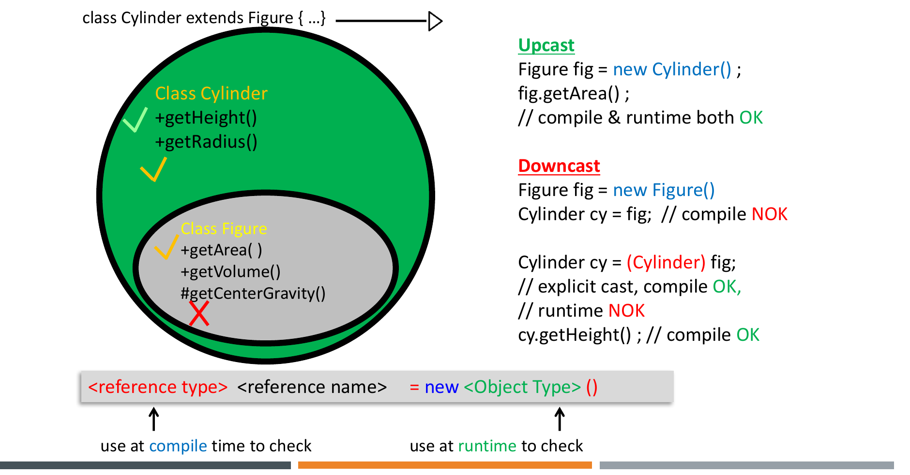

# Polymorphism, Binding and Typecasting

<style>
table.wide-table { width: max-content; min-width: 100%; table-layout: auto; }
</style>

This chapter covers Lecture 5. Many quiz questions give a short class
hierarchy and ask "what is printed?" or "does it compile?". Section 3 gives a
fixed method that answers all of them.

## 1. Polymorphism

**Polymorphism** means "many forms". In OO, it means that one reference
variable can refer to objects of different types. When you call a method
through that reference, Java runs the version that belongs to the **real
object**.

```java
Animal animal = new Eagle();
animal.move();          // Eagle's move()
animal = new Tiger();
animal.move();          // Tiger's move()

void call(Animal a) { a.move(); }   // works for every Animal subclass, now and later
```

Overriding is the tool that makes polymorphism work: each subclass overrides
`move()`.

### Two types and two times

Every object variable has two types:

```java
Shape s = new Circle();
// Shape  = declared type (reference type). The compiler uses it.
// Circle = object type (actual type).      The JVM uses it at run time.
```

- **Compile time**: the compiler sees only the **declared type**. It checks
  that the method exists in that type.
- **Run time**: the JVM sees the **real object**. It picks which overriding
  version to run.

### Benefits of polymorphism

1. **Simplicity.** Code for a family of types talks only to the base type. It
   ignores the details of each subclass, so it is easier to write and read.
2. **Extensibility.** You add a new subclass without changing the base class,
   the other subclasses, or the code that uses the base type. A method
   `printArea(Shape s)` works for a new `Triangle` with no change.

Compare with the non-polymorphic way: overloaded methods `printArea(Rectangle
r)`, `printArea(Triangle t)`. Each new subclass needs a new method in the
caller. This is **static binding**, and it is harder to extend.

### Liskov Substitution Principle (LSP)

"Subtypes must be substitutable for their base types." Code written for a
`Shape` must still work correctly when it gets any subclass of `Shape`.
Polymorphism is only safe when subclasses obey this. Chapter 8 gives the full
rule.

## 2. Binding

**Binding** connects a method call to the method body that runs.

| | Static binding (early) | Dynamic binding (late) |
|---|---|---|
| When | Compile time | Run time |
| Based on | Declared type (of the receiver and the arguments) | Real object of the receiver |
| Used for | Overloaded methods; `static`, `private`, `final` methods; fields | Overridden instance methods (all others) |

: { .wide-table }

Java uses dynamic binding by default, for every instance method that is not
`private`, `final` or `static`. Because of dynamic binding, a base class
method can call a method that only the subclasses define. "Program in the
general, not in the specific."

```java
class Sale {
    public double bill() { return price; }
    public boolean lessThan(Sale other) { return bill() < other.bill(); }
}
class DiscountSale extends Sale {
    public double bill() { return (1 - discount / 100) * getPrice(); }
}
// lessThan was written before DiscountSale existed,
// but bill() inside it runs DiscountSale's version for a DiscountSale object.
```

## 3. The Method for "What Does This Print?"

For a call `ref.method(args)`:

**Step 1, compile time (use the declared type of `ref`).**

1. Look in the **declared type** of `ref` (and its parents) for methods with
   that name.
2. Pick the overload whose parameter types match the **declared types of the
   arguments**. Prefer the exact match; otherwise the closest widening match.
3. If no method matches, it is a **compile error**, even if the real object
   has the method.

**Step 2, run time (use the real object).**

1. If the chosen method is `static`, `private` or `final`, run the Step 1
   method. Done.
2. Otherwise, start at the **real object's class**. Find a method with exactly
   the signature from Step 1. Go up the parents until you find one. Run it.

**Fields never use dynamic binding.** `ref.field` always uses the declared
type of `ref`.

### Worked examples

```java
class A { int x = 1; void print() { System.out.println("A: " + x); } }
class B extends A { int x = 2; void print() { System.out.println("B: " + x); } }

A obj = new B();
System.out.println(obj.x);   // 1      (field: declared type A)
obj.print();                 // B: 2   (method: real object B)
```

```java
class Animal { void print(Animal a) { System.out.println("Animal"); } }
class Cat extends Animal { void print(Cat c) { System.out.println("Cat"); } }

Animal a1 = new Cat();
Cat c = new Cat();
c.print(a1);   // "Animal": argument a1 is declared Animal, so print(Animal) is picked
c.print(c);    // "Cat":    argument is declared Cat, print(Cat) is the exact match
a1.print(c);   // "Animal": declared type Animal has only print(Animal)
```

`print(Cat)` does **not** override `print(Animal)`, because the parameter
types differ. It is an overload. So dynamic binding never chooses it from an
`Animal` call.

```java
Animal a = new Dog();
a.makeSound();   // OK: runs Dog's makeSound()
a.bark();        // COMPILE ERROR: Animal has no bark(), even though the object is a Dog
```

**Three-level example** (abstract class + override + inherit):

```java
abstract class LivingThings { public void grow() { System.out.println("LivingThings grow"); }
                              public abstract void speak(); }
abstract class Mammal extends LivingThings {
    public void move() { System.out.println("Mammal move"); }
    public void grow() { System.out.println("Mammal grow"); }
    public void eat()  { System.out.println("Mammal eat"); } }
class Dog extends Mammal {
    public void speak() { System.out.println("Woof"); }
    public void move()  { System.out.println("Dog move"); }
    public void grow()  { System.out.println("Dog grow"); } }

Mammal m = new Dog();
m.speak(); m.move(); m.eat(); m.grow();
// Woof / Dog move / Mammal eat / Dog grow
```

`eat()` is inherited from `Mammal`; the other three run `Dog`'s overrides.

## 4. Typecasting Objects

### Upcasting

**Upcasting** puts a subclass object in a superclass variable. It is automatic
and always safe, because a subclass object *is* a superclass object.

```java
Shape shape = new Rectangle(15, 10);   // upcast
shape.findArea();                      // runs Rectangle's findArea()
shape.getWidth();                      // COMPILE ERROR if Shape has no getWidth()
```

**The cost of upcasting**: through the superclass variable, you can only call
methods that the **superclass** declares. Subclass-only methods are hidden
until you downcast.

### Downcasting

**Downcasting** puts a superclass reference into a subclass variable. It needs
an explicit cast, and it can fail at run time.

```java
Shape s1 = new Rectangle();
Rectangle r1 = (Rectangle) s1;   // OK: the object really is a Rectangle

Shape s2 = new Shape();
Rectangle r2 = s2;               // COMPILE ERROR: needs a cast
Rectangle r3 = (Rectangle) s2;   // compiles, but ClassCastException at run time
```

The compiler checks only that the cast *could* work. It does not check the
real object. The programmer must make sure the downcast makes sense.



### The two checks for `(Target) ref`

**Check 1, compile time.** Is the cast possible at all?

- It compiles if `Target` and the declared type of `ref` are in the same
  inheritance line (one is a parent of the other).
- It also compiles if one of them is an **interface** and the other is a class
  that is not `final` (a hidden subclass could implement the interface).
- Two unrelated classes (siblings, or no link): **compile error**,
  "incompatible types".

**Check 2, run time.** Is the real object a `Target` (or a subclass of
`Target`)? If no, Java throws a **`ClassCastException`**.

| Code | Result |
|---|---|
| `Parent p = new Child(); Child c = (Child) p;` | Compiles and runs |
| `Parent p = new Parent(); Child c = (Child) p;` | Compiles, then `ClassCastException` |
| `Parent p = new Parent(); Child c = p;` | Compile error (no cast) |
| `Sibling s = (Sibling) new Parent();` (unrelated classes) | Compile error |
| `Runnable r = (Runnable) someNonFinalObject;` | Compiles; fails at run time if the object does not implement `Runnable` |
| `X x1 = new Z(); Y y = (Y) x1;` where `Z extends Y extends X` | Compiles and runs: the object is a `Z`, and a `Z` is a `Y` |

: { .wide-table }

### Assignment rules in one list

- Superclass object to superclass variable: fine. (`Object ob = new Object();`)
- Subclass object to subclass variable: fine. (`String st = new String();`)
- Subclass object to superclass variable: fine, by "is-a". (`Object o = new
  String();`) But `o.charAt(0)` is a compile error.
- Superclass reference to subclass variable: compile error without a cast.
  With a cast it compiles, and it works only if the object really is the
  subclass.

### `instanceof`

`obj instanceof ClassName` is `true` if `obj` is a `ClassName` **or any
subclass** of it. It is `false` for `null`. Use it to guard a downcast:

```java
if (person instanceof Student) {
    Student s = (Student) person;   // safe
    s.takeExam();
}
// Java 16+: if (person instanceof Student s) { s.takeExam(); }
```

## 5. Downcasting in `equals`

`Object` has `equals(Object o)`. To compare two objects by content, override
it. The parameter is `Object`, so you must downcast inside:

```java
public boolean equals(Object other) {
    if (other == null) return false;
    if (!(other instanceof Person)) return false;   // or: getClass() != other.getClass()
    Person p = (Person) other;                      // safe downcast
    return name.equals(p.name) && age == p.age;
}
```

- `instanceof` lets a subclass object be equal to a parent object if the
  fields match.
- `getClass() != other.getClass()` accepts only objects of the exact same
  class.
- The parameter must be `Object`. `equals(Person p)` is an **overload**, not an
  override, so `Object`-typed calls (as in collections) do not use it.

## 6. Quiz Traps

- Method called through a parent reference: the **real object's** override
  runs. Field read through a parent reference: the **declared type's** field.
- The method must exist in the **declared type**, or it is a compile error.
- Overloads are picked at compile time from the declared types of the
  arguments.
- A static method called through a reference uses the declared type.
- Downcast to the wrong object type: compiles, then `ClassCastException`.
  Cast between unrelated classes: compile error.
- `null instanceof X` is `false`.
- Benefits of polymorphism: **simplicity** and **extensibility**.
