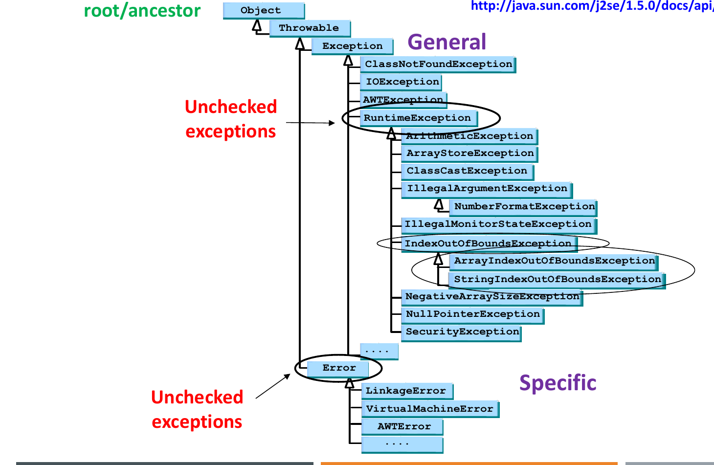

# Exception Handling and File I/O

<style>
table.wide-table { width: max-content; min-width: 100%; table-layout: auto; }
</style>

This chapter covers Lecture 4 (exception handling) and Lecture 4.5 (file
input and output). Quiz questions here are mostly "trace the output" with
`try`, `catch` and `finally`. Section 4 gives the rules for that.

## 1. What an Exception Is

An **exception** is a problem that happens while the program runs (a run-time
anomaly). Examples: division by zero, an array index out of range, a file that
does not exist, memory that runs out.

Without handling, an exception stops the program. With handling, the program
catches the exception, recovers, and continues. Example: there are 10
statements, and statement 5 throws an exception. Without a handler, statements
6 to 10 do not run.

The old way is to test with `if` and call `System.exit(0)`. That mixes error
code with normal code, and the program ends. Java's way separates them:

- **Try**: run code that can fail, inside a `try` block.
- **Throw**: when a statement finds a problem, it creates an exception object
  and throws it. The object holds the type of the problem and a message.
- **Catch**: the JVM looks for a `catch` block whose type matches the thrown
  object. That block handles it.

## 2. Syntax

```java
try {
    // normal code; at least one statement can throw
    if (numOfStudents <= 0)
        throw new Exception("Error: no of students must not equal to 0!");
    avg = total / numOfStudents;
}
catch (ArithmeticException e) {        // more specific first
    System.out.println(e.getMessage());
}
catch (Exception e) {                  // more general last
    System.out.println(e.getMessage());
}
finally {
    // optional; runs whether an exception happened or not
    System.out.println("End of program execution!");
}
```

- `throw` (no s) throws one exception object: `throw new X("msg");`
- `throws` (with s) goes in a method header. It lists the checked exceptions
  that the method can pass to its caller:
  `public double computeAvg() throws IOException`.
- A `try` needs at least one `catch` or a `finally`.

### Useful methods of every exception

| Method | Gives |
|---|---|
| `getMessage()` | The message string given to the constructor (can be `null`) |
| `toString()` | Class name plus message, e.g. `java.lang.ArithmeticException: / by zero` |
| `printStackTrace()` | Prints the chain of method calls that led to the exception |

: { .wide-table }

`Exception` has two constructors: `Exception()` and `Exception(String
message)`.

## 3. The Exception Hierarchy



`Throwable` is the parent of `Exception` and `Error`. `Exception` is the root
of all exceptions that a program normally handles.

### Checked and unchecked exceptions

| | Checked | Unchecked |
|---|---|---|
| Which classes | `Exception` and its subclasses, **except** `RuntimeException` | `RuntimeException` and its subclasses, plus `Error` and its subclasses |
| Examples | `IOException`, `FileNotFoundException`, `ClassNotFoundException`, `Exception` itself | `ArithmeticException`, `NullPointerException`, `ArrayIndexOutOfBoundsException`, `ClassCastException`, `NumberFormatException`, `IllegalArgumentException` |
| Compiler checks? | **Yes.** You must **catch** it or **declare** it with `throws`. If you do neither, it is a compile error. | No. Handling is optional. |
| Usual cause | Things outside the program (missing file, network) | Programming mistakes or bad input; prevent them with good code |

: { .wide-table }

If an unchecked exception is not caught, Java's default handler stops the
program and prints the exception's class name and the stack trace.

### Common exceptions

| Exception | Cause |
|---|---|
| `ArithmeticException` | Integer division by zero (`10 / 0`). Message: `/ by zero`. (Floating-point `10.0 / 0` gives `Infinity`, no exception.) |
| `ArrayIndexOutOfBoundsException` | Array index `< 0` or `>= length` |
| `StringIndexOutOfBoundsException` | String index `< 0` or `>= length()` |
| `NullPointerException` | Calling a method or reading a field through a `null` reference |
| `NumberFormatException` | `Integer.parseInt("abc")` (a subclass of `IllegalArgumentException`) |
| `IllegalArgumentException` | A method got an argument it does not accept |
| `ClassCastException` | A downcast to a type that the object is not |
| `InputMismatchException` | `Scanner.nextInt()` read a non-number |
| `FileNotFoundException` | A file to open does not exist (checked; subclass of `IOException`) |
| `EOFException` | Reading past the end of a binary file (checked; subclass of `IOException`) |

: { .wide-table }

## 4. Rules for Tracing `try` / `catch` / `finally`

1. Statements in `try` run in order. At the first exception, the rest of the
   `try` block is **skipped**.
2. Java checks the `catch` blocks **from top to bottom**. It runs only the
   **first** block whose type matches (the thrown class or a parent of it).
   The other `catch` blocks are skipped.
3. `finally` runs **always**: after a normal `try`, after a `catch`, and also
   when no `catch` matches. It runs even when the `try` or `catch` has a
   `return`. (Only `System.exit()` stops it.)
4. If a `catch` handled the exception, the program continues with the
   statement **after** the whole `try`-`catch`-`finally`.
5. If no `catch` matched, then after `finally` the exception leaves the
   method. The rest of the method does **not** run. The exception goes to the
   caller (Section 5).

**Example** (from Tutorial 4):

```java
public static void sampleMethod(int n) throws Exception {
    try {
        if (n > 0)      throw new Exception();
        else if (n < 0) throw new NegativeNumberException();
        else            System.out.println("No Exception.");
        System.out.println("Still in sampleMethod.");
    }
    catch (NegativeNumberException e) { System.out.println("Caught in sampleMethod."); }
    finally { System.out.println("In finally block."); }
    System.out.println("After finally block.");
}
// main: try { sampleMethod(n); } catch (Exception e) { System.out.println("Caught in main."); }
```

| `n` | Output | Why |
|---|---|---|
| `99` | In finally block. / Caught in main. | `Exception` does not match the `NegativeNumberException` catch. `finally` runs, then the exception goes to `main`. "After finally" is skipped. |
| `-99` | Caught in sampleMethod. / In finally block. / After finally block. | The catch matches, then `finally`, then the method continues. |
| `0` | No Exception. / Still in sampleMethod. / In finally block. / After finally block. | No exception. |

: { .wide-table }

Short pattern: `try { A; 10/0; B; } catch { C; } finally { D; } E;` prints
**A C D E**. B is skipped.

## 5. Exception Propagation

If a method does not catch an exception, the exception goes to the method
that called it, then to that method's caller, and so on (**propagation**).
Each method on the way stops at once. The first method with a matching `catch`
handles it. If even `main` does not catch it, the program stops.

```
main() calls method1()            method1 has try { method2(); } catch (ArrayIndexOutOfBoundsException e)
method1() calls method2()         method2 has no try
method2() calls method3()         method3 does array[6] = 10 on an array of 5
```

Output order: Start method1 → Start method2 → Start method3 → exception in
method3 → "End method3" and "End method2" are **skipped** → method1's catch
runs → "End method1" → "End of program". The stack trace lists method3,
method2, method1, main (newest call first).

## 6. Multiple `catch` Blocks

- One method can throw several kinds of exceptions, and one `try` can have
  several `catch` blocks.
- A `catch` for a parent class also catches every subclass ("is-a").
- So put **specific** exceptions first and **general** ones last. If a parent
  `catch` (e.g. `Exception`) comes before a child `catch` (e.g.
  `ArithmeticException`), the child block can never run. The compiler reports
  an error: "exception … has already been caught".
- A `catch` for a **checked** exception that the `try` body can never throw is
  also a compile error. (`catch (Exception e)` is always allowed.)

## 7. Your Own Exception Class

```java
public class IntNonNegativeException extends Exception {   // checked
    public IntNonNegativeException() {
        super("Integer input is a negative number!!");     // default message
    }
    public IntNonNegativeException(String message) {
        super(message);                                    // caller's message
    }
}
```

- It must extend an existing exception class. Extend `Exception` for a checked
  exception, or `RuntimeException` for an unchecked one.
- Usually you write only constructors. Each one calls `super(message)`, so
  `getMessage()` returns that message.
- Throw it with `throw new IntNonNegativeException();`.

### Exceptions and overriding

An overriding method cannot throw a new or broader **checked** exception than
the method it overrides. It can throw fewer, narrower or unchecked ones. (If
`A.m()` throws nothing, `B.m() throws Exception` does not compile.)

## 8. File Input and Output

### Data in files

Data goes from small to big: bit → byte → field → record → file. A **record**
holds all the fields for one thing (one employee). A **sequential file** is
read from start to end. A **random-access file** can jump to any record.

A **stream** is a flow of bytes to or from a file. Java has two modes:

| | Text mode | Binary mode |
|---|---|---|
| Data stored as | Characters | Raw bytes (0s and 1s) |
| File examples | `.txt`, `.java` | `.exe`, `.class`, `.ppt` |
| Write classes | `FileWriter` → `BufferedWriter` → `PrintWriter` | `FileOutputStream` → `BufferedOutputStream` → `ObjectOutputStream` |
| Read classes | `FileReader` → `BufferedReader`, or `Scanner(new File(...))` | `FileInputStream` → `BufferedInputStream` → `ObjectInputStream` |
| End of file | `readLine()` returns `null`; `hasNext()` is `false` | `readInt()` etc. throw `EOFException` |

: { .wide-table }

All these classes are in `java.io`. Each layer wraps the one before it. The
`Buffered…` layer collects data in memory to make reading and writing faster.
The outer layer gives handy methods (`println`, `readLine`, `writeInt`).

### Text files

```java
import java.io.*;
// write
try {
    PrintWriter pw = new PrintWriter(new BufferedWriter(new FileWriter("data.txt")));
    for (int i = 0; i < 5; i++) pw.println("Number = " + i * 5);
    pw.close();                         // close() also flushes the buffer
} catch (IOException e) { System.out.println("IO Error!" + e.getMessage()); }

// read until end of file
try {
    BufferedReader br = new BufferedReader(new FileReader("data.txt"));
    String line = br.readLine();
    while (line != null) {              // null = end of file
        System.out.println(line);
        line = br.readLine();
    }
    br.close();
} catch (FileNotFoundException e) {     // specific first
    System.out.println("Error opening the input file!");
} catch (IOException e) {               // general last
    System.out.println("IO Error!");
}
```

- Close every stream. If you do not close or `flush()` a buffered writer, the
  last data can stay in the buffer and never reach the file.
- `new FileWriter(name)` **overwrites** the file. `new FileWriter(name, true)`
  adds to the end (append).
- A `Scanner` can read a file too: `new Scanner(new File("data.txt"))` with
  `hasNext()` and `nextLine()`.

### Binary files

Write with `writeInt`, `writeDouble`, `writeUTF` (a string), and so on. Read
the values back with `readInt`, `readDouble`, `readUTF` **in the same order
and with the same types**. A loop `while (true)` that reads records stops when
`readUTF()` throws `EOFException`; catch it to detect the end of the file.

### Object serialization

**Serialization** saves a whole object as a sequence of bytes, with its data
and its type information. **Deserialization** rebuilds the object from the
bytes later.

- `ObjectOutputStream.writeObject(obj)` writes an object.
  `ObjectInputStream.readObject()` reads one back. It returns `Object`, so you
  must downcast it to its real type.
- The class must implement **`Serializable`**. This is a **marker (tagging)
  interface**: it has no methods. It only marks the class as safe to
  serialize. `ObjectOutputStream` refuses an object that is not `Serializable`.
- Every field must be serializable too. Primitives always are. Mark a field
  that must not be saved as **`transient`**; serialization skips it.
- `readObject()` throws `EOFException` at the end of the file, and
  `ClassNotFoundException` if Java cannot find the object's class.

## 9. Quiz Traps

- After an exception in `try`, the rest of `try` is skipped.
- Only the **first** matching `catch` runs. Parent `catch` before child
  `catch`: compile error.
- `finally` always runs, even with `return` in `try`. After an uncaught
  exception, `finally` runs, then the method ends (the statements after
  `finally` do not run).
- Checked exceptions (`Exception`, `IOException`) must be caught or declared.
  `RuntimeException` subclasses and `Error` are unchecked.
- `throw` throws an object; `throws` declares in a header.
- A custom exception passes its message with `super(message)`.
- `readLine()` returns `null` at end of file; binary reads throw `EOFException`.
- `Serializable` has no methods; `transient` fields are not saved.
