# UML Class Diagrams and Class Relationships

<style>
table.wide-table { width: max-content; min-width: 100%; table-layout: auto; }
</style>

This chapter covers Lecture 6 (UML class diagrams and class relationships).
The quiz tests three skills: name the relationship from a description or from
code, read the notation, and turn a diagram into code (or code into a diagram).

## 1. Why Model, and What UML Is

A **model** is a simple version of a real thing. It helps people see the
problem, talk about it, design the solution, and keep a record. A good model
keeps only what matters for its purpose. "Everything should be made as simple
as possible, but not simpler."

The **Unified Modeling Language (UML)** is a visual language to specify,
document and communicate the design of a software system. Booch, Jacobson and
Rumbaugh made it (1996). The Object Management Group (OMG) adopted it (1997).

UML has two families of diagrams:

| Structure diagrams (static: what exists) | Behaviour diagrams (dynamic: what happens) |
|---|---|
| **Class diagram**, object diagram, component, deployment, package, composite structure | **Sequence diagram**, use case, activity, state machine, communication, timing, interaction overview |

: { .wide-table }

This course uses the **class diagram** (this chapter) and the **sequence
diagram** (Chapter 7).

## 2. One Class in UML

A class is a box with three parts: the name, the attributes, and the
operations.

![A UML class: attribute format "name: type [multiplicity] = initial-value"; operation format "name(parameter-list): return type".](images/6-class-notation.png)

| Item | Format | Example |
|---|---|---|
| Attribute | `visibility name: type [multiplicity] = initial-value` | `- isPrepaid: Boolean = FALSE` |
| Operation | `visibility name(parameter-list): return-type` | `+ dispatch(in d: Date): Boolean` |
| Parameter | `direction name: type = default-value` | `in dateDispatched: Date` |

: { .wide-table }

- Parameter direction is `in`, `out` or `inout`.
- Visibility: `+` public, `-` private, `#` protected, `~` package.
- A **static** member is **underlined**.
- An **abstract** class or operation is in *italics*, or has `{abstract}`.
- An **interface** has the stereotype `<<interface>>` above its name.
- An **enumeration** has `<<enumeration>>` and lists its values (`Sunday`,
  `Monday`, …).
- A constructor is shown as an operation with the class name, with no return
  type: `+ Employee(String)`.

## 3. The Six Relationships

Learn these six lines. The quiz often shows a line and asks its name, or asks
which line fits a description.

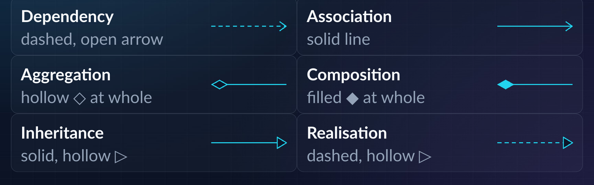

| Relationship | Meaning | Line | Java code |
|---|---|---|---|
| **Dependency** | "uses-a", for a short time | Dashed, open arrow → to the class used | Parameter, return type, or local variable |
| **Association** | "has-a" / "knows-a", long-term | Solid line (arrow shows direction) | A field |
| **Aggregation** | Weak "part-of" | Solid line, **hollow** diamond ◇ at the **whole** | A field; part made outside and passed in |
| **Composition** | Strong "part-of" | Solid line, **filled** diamond ◆ at the **whole** | A field; part made inside the whole |
| **Inheritance** (generalisation) | "is-a" | **Solid** line, hollow triangle ▷ at the **parent** | `extends` |
| **Realisation** | "implements" | **Dashed** line, hollow triangle ▷ at the **interface** | `implements` |

: { .wide-table }

The hollow triangle always points to the more general (more abstract) side.

Grouped by meaning:

- **is-a**: inheritance, realisation.
- **uses-a**: dependency.
- **has-a**: association.
- **part-of**: aggregation, composition (special kinds of association).

## 4. Inheritance and Realisation

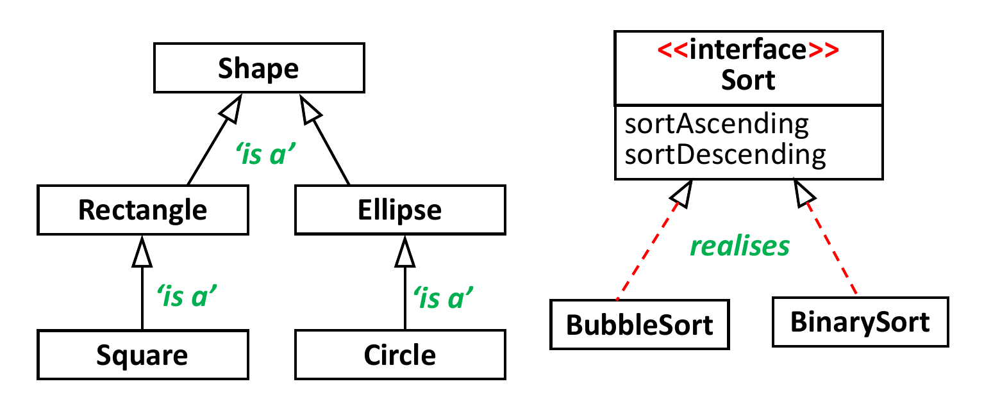

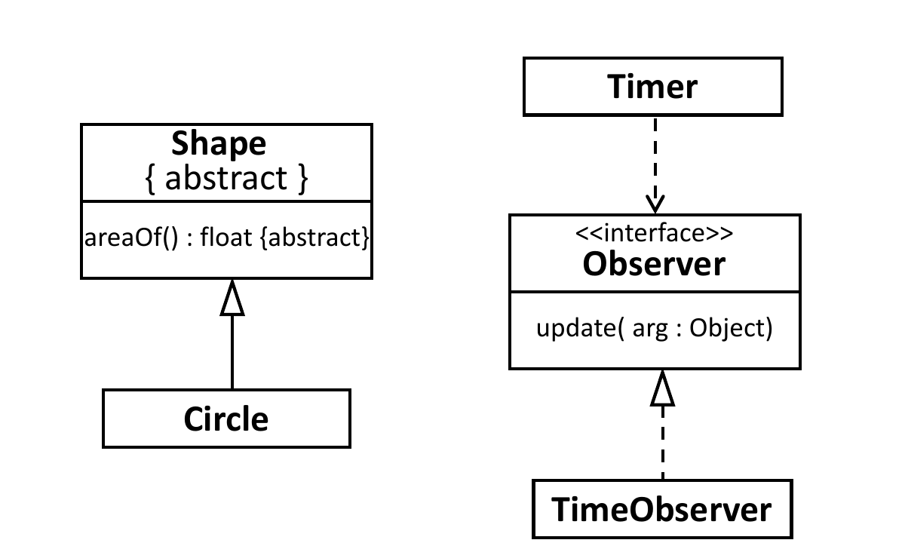

- **Generalisation**: class to class, or interface to interface. In Java:
  `extends`.
- **Realisation**: class to interface. In Java: `implements`.
- An interface that extends an interface uses the generalisation line (solid),
  because no implementation happens. Only a class *implements* an interface.
- An abstract class is still a class. It uses generalisation to its parent
  class and realisation to an interface.
- Multiplicity is **not** used on is-a lines.

## 5. Dependency: "uses-a"

A **dependency** means one class uses another class for a short time to do a
task. It does **not** keep a reference as a field. The link ends when the
method ends.

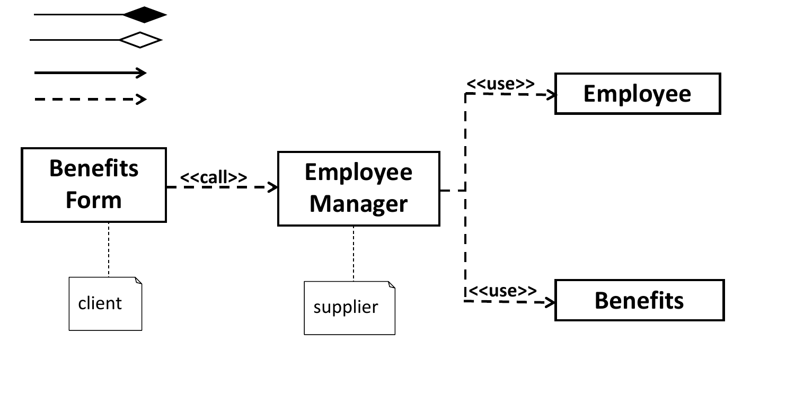

```java
class ClassA {
    ClassB make() { ... }                       // ClassB as a return type
    void use(ClassB b) { b.callMethod(); }      // ClassB as a parameter
    void work() { ClassB b = new ClassB(); }    // ClassB as a local variable
}
```

- The arrow goes from the **client** (the user) to the **supplier** (the class
  used). A change in the supplier can affect the client.
- Examples: a `Student` uses a `VendingMachine`; a `Teacher` uses a
  `TutorialRoom`; a `PaymentService` gets a `CreditCard` as a parameter and
  does not store it.
- A stereotype such as `<<use>>`, `<<call>>` or `<<instantiate>>` can name the
  kind of dependency.

**Dependency vs association**: is the other object stored in a **field**?

```java
public class A {
    private C c;                              // A–C: association (field)
    public void myMethod(B b) { b.callMethod(); }   // A–B: dependency (parameter only)
}
```

A `Teacher` whose `teach(Student s)` takes a student as a parameter has a
**dependency** on `Student`. The teacher cannot "remember" the students after
the method ends. If `Teacher` has a field `Student mentee`, it is an
**association**.

## 6. Association: "has-a"

An **association** is a long-term link. One class holds a reference to the
other in a **field**, so the objects can talk to each other over their whole
lives.

### Direction (navigability)

- A plain line with no arrows: **bi-directional** (the default). Each class
  has a field of the other type. A student knows the teacher, and the teacher
  knows the student.
- An arrow on one end: **uni-directional**. Only the class at the tail holds a
  field. `A → B` means A has a `B` field; B does not know A.
- An `x` on an end means "not navigable" from that side.

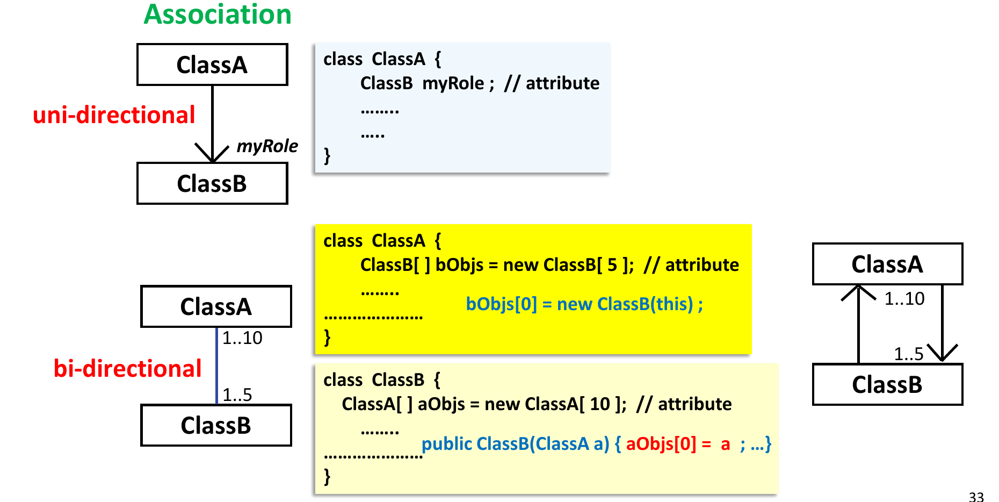

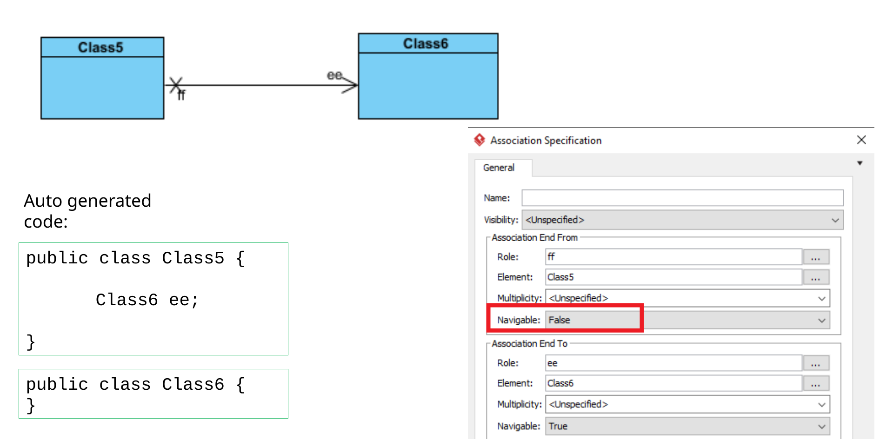

### Labels on an association

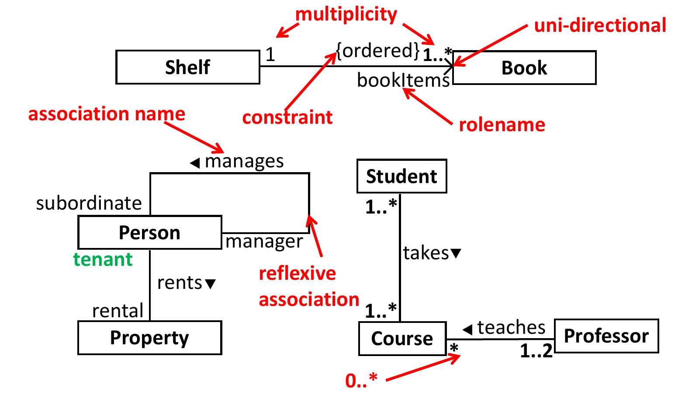

| Label | Where | What it says | Example |
|---|---|---|---|
| **Association name** | Middle of the line, usually with a ▶ to show reading direction | The meaning of the link, as a **verb** phrase | `takes`, `teaches`, `rents` |
| **Role name** | At one end | The part the object at that end plays. Often the field name in code. | `bookItems`, `manager`, `tenant` |
| **Multiplicity** | At each end | How many objects at **that** end link to one object at the other end | `1`, `0..1`, `1..*`, `*` |
| **Constraint** | In `{ }` near the line or in a note | A rule that must hold | `{ordered}`, `{project > $1m}` |

: { .wide-table }

- Association names and role names are optional. Add them when the link would
  otherwise be unclear, or when one class plays two roles.
- The association name says what the link means. It does **not** say which
  method is called. "Student enrols in Course" can be done by
  `student.enroll(course)`, `course.addStudent(student)`, or a third object.
- A **reflexive association** links a class to itself, for example a `Person`
  who manages other `Person` objects (roles `manager` and `subordinate`).

### Multiplicity

| Notation | Meaning |
|---|---|
| `1` | Exactly one |
| `0..1` | Zero or one (optional) |
| `*` or `0..*` | Zero or more |
| `1..*` | One or more |
| `1..2` | One or two |
| `4` | Exactly four |

: { .wide-table }

- **Read it from the far end.** The number next to class B tells how many B
  objects link to **one** A object. `Shelf 1 —— 1..* Book` means one shelf
  holds one or more books, and each book is on exactly one shelf.
- In code, a `1` or `0..1` end becomes a single field. A `*` end becomes an
  array or a collection (`ClassB[]`, `List<ClassB>`).
- Multiplicity applies only to **has-a** relationships (association,
  aggregation, composition), not to inheritance or dependency.
- Check that code matches: `Company` with a single `Employee staff` field
  cannot model a company with many employees.

### Constraints

A **constraint** states a rule about the classes and their objects. It mostly
goes on has-a links (sometimes on dependency, almost never on inheritance).

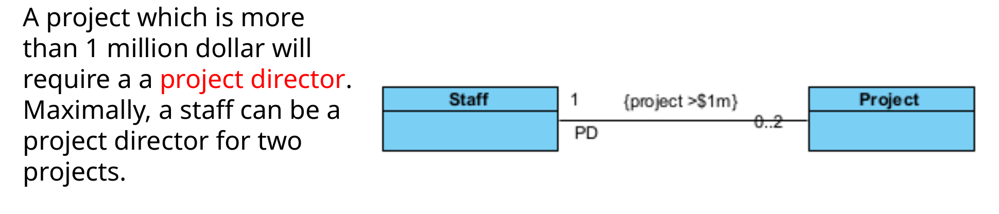

### Association class

When the link itself has data, use an **association class**. A `Loan` between
`Borrower` and `Equipment` has a `date`. The date does not belong to the
borrower or to the equipment; it belongs to the loan. Draw the `Loan` class
joined by a dashed line to the association, or make `Loan` a normal class
between the two.

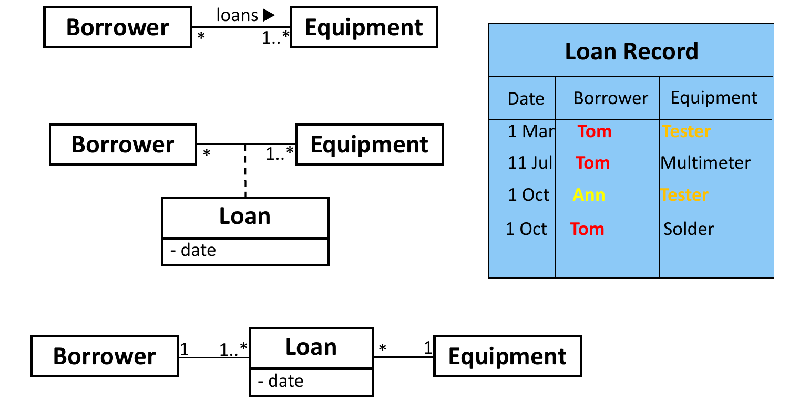

## 7. Aggregation and Composition: "part-of"

Both are special associations with a **whole** and its **parts**. The diamond
is always at the **whole**.

| | Aggregation (weak) | Composition (strong) |
|---|---|---|
| Diamond | Hollow ◇ | Filled ◆ |
| Can the part exist without the whole? | **Yes** | **No**, the part lives and dies with the whole |
| Can a part belong to many wholes? | Yes | No, at most one whole at a time |
| Who makes the part? | Made **outside**, then added through a reference | Made **inside** the whole (often in its constructor) |
| Multiplicity at the whole | Any (`*`, `1..*`) | `1` or `0..1` |
| Examples | Team–Player, LectureGroup–Person, Family–Person, VendingMachine–CanDrink | Human–Arm, Human–Leg, Arm–Hand, House–Room |

: { .wide-table }

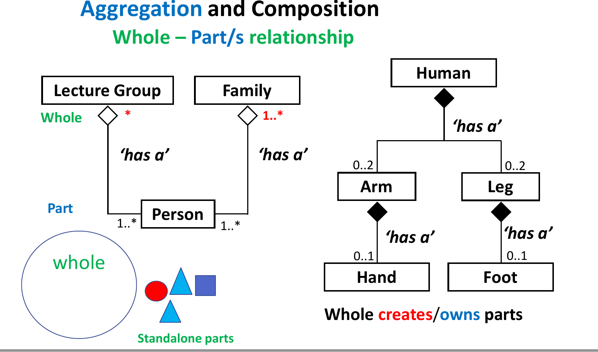

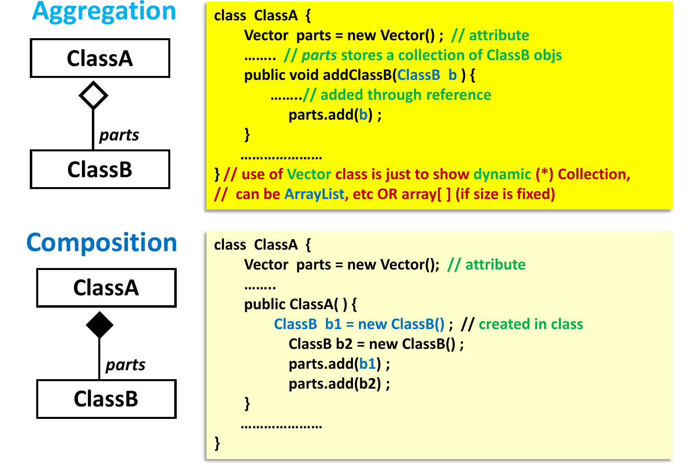

```java
// Aggregation: the part already exists; the whole only stores a reference
class Team {
    private List<Player> players = new ArrayList<>();
    public void addPlayer(Player p) { players.add(p); }
}

// Composition: the whole creates and controls its parts
class House {
    private List<Room> rooms = new ArrayList<>();
    public House() {
        rooms.add(new Room());
        rooms.add(new Room());
    }
}
```

**How to decide**: ask "if I delete the whole, do the parts still make
sense?" If a team breaks up, the players still exist: aggregation. If a person
is deleted, the person's hands go too: composition.

The words "has-a" and "part-of" describe the same link from two sides: "A
tutorial group **has** students" and "A student is **part of** a tutorial
group". "A student **is a** tutorial group" (inheritance) and "a student
**uses** a tutorial group" (dependency) are wrong for that pair.

## 8. Summary: UML to Java Code

| Diagram | Java |
|---|---|
| `A —▷ B` (solid, hollow triangle) | `class A extends B` |
| `A - - ▷ B` (dashed, hollow triangle) | `class A implements B` |
| `A - - > B` (dashed, open arrow) | B appears only as a parameter, return type or local variable in A |
| `A ——> B` multiplicity `1` | `class A { B b; }` |
| `A ——> B` multiplicity `*` | `class A { B[] bs; }` or `List<B> bs` |
| `A —— B` (no arrows) | A has a B field and B has an A field |
| `A ◇—— B` | A has a B field (or collection); B objects are passed in |
| `A ◆—— B` | A has a B field (or collection); A creates the B objects |

: { .wide-table }

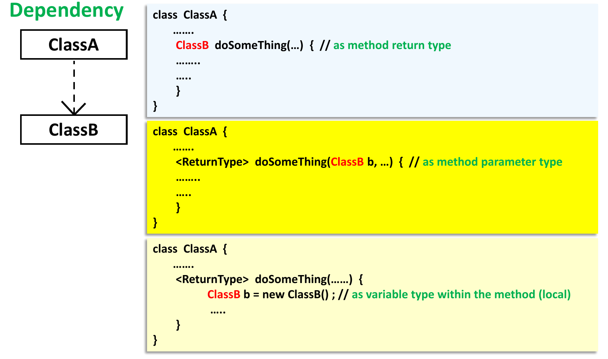

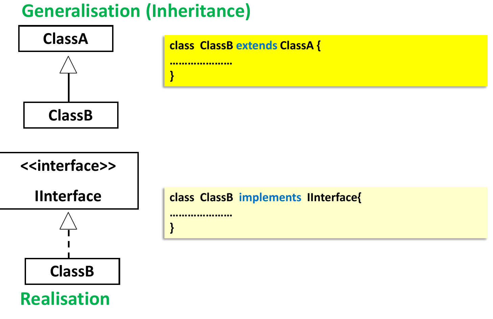

## 9. Object Diagram

An **object diagram** shows real objects and their links at one moment, not
classes.

- Write each object as `objectName : ClassName`, **underlined**. The object
  name is optional (`:Book` is an anonymous object).
- Show attribute **values**: `title = "Twelfth Night"`.
- A line between two objects is a **link** (one instance of an association).

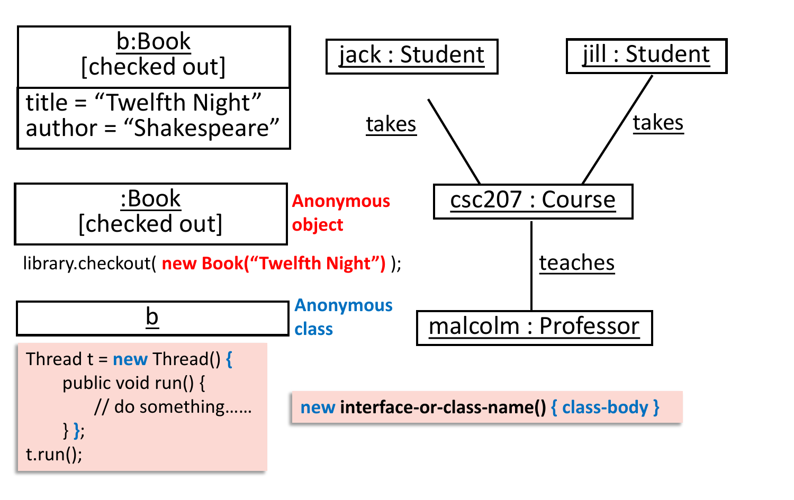

## 10. Class Stereotypes: Boundary, Control, Entity (BCE)

**BCE** is a modelling pattern (Ivar Jacobson, OOSE). It gives each class one
kind of job, early in design, before any code. It is close to MVC
(Model–View–Controller), but you use it earlier, during use-case modelling.

| Stereotype | Job | Usual names | Example |
|---|---|---|---|
| **Boundary** `<<boundary>>` | Talks to the outside world: the user or another system. Reads input, shows output. | `xxxUI`, `xxxForm`, `xxxInterface` | `InvoiceForm`, `UtilisationUI` |
| **Control** `<<control>>` | Runs the steps of a use case. Coordinates other objects. | `xxxMgr`, `xxxController`, `xxxCtrl` | `CourseMgr`, `RideController` |
| **Entity** `<<entity>>` | Holds data that the system must remember, and the rules on that data. | Domain nouns | `Student`, `Course`, `Player`, `Match` |

: { .wide-table }

Chapter 7 shows how the three work together in a sequence diagram.

## 11. From Requirements to a Class Diagram

1. **Entity classes**: mark the **nouns**. Keep nouns that appear many times,
   and nouns that have their own details. Drop nouns that are the whole system
   (`WTA`), only another name for a class, or only a value of another class
   (these become attributes).
2. **Relationships**: mark the **verbs**. "is part of" / "is broken down into"
   gives aggregation or composition. "is a special" / "can be" gives
   inheritance. Other verbs give associations (with that verb as the name).
3. **Attributes**: the nouns that describe an entity (`id`, `title`,
   `status`).
4. **Role names**: nouns that name an object in a special role, such as
   "project manager" or "project director" (both are `Staff`).
5. **Multiplicity**: words about quantity: "a", "one to two", "multiple",
   plural nouns ("team members").
6. **Enumerations**: a fixed list of values ("type of work can be
   administrative, project, on leave, training, mentoring").
7. **Constraints**: conditions ("a project above $1 million requires a project
   director").

### Common errors in class diagrams

- Diamond at the part end instead of the whole end.
- Hollow triangle pointing to the subclass.
- A solid line for realisation, or a dashed line for inheritance.
- A class "implementing" a class, or an interface "implementing" an interface.
- Multiplicity on an inheritance line.
- Multiplicity that does not match the code (one field for a `*` end).

## 12. Quiz Traps

- Parameter or local variable only: **dependency**. Field: **association**
  (or aggregation/composition).
- Diamond goes at the **whole**. Hollow = aggregation (part can live alone).
  Filled = composition (part dies with the whole).
- The part is created inside the whole: composition. Passed in from outside:
  aggregation.
- Triangle points to the parent. Solid = `extends`; dashed = `implements`.
- No arrows on an association means bi-directional.
- Multiplicity: read the number at the far end. Only on has-a links.
- Association names are verbs; role names are nouns at the ends.
- Boundary = UI, Control = coordinates a use case, Entity = stored data.
