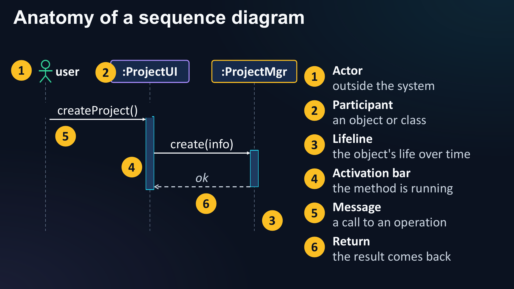
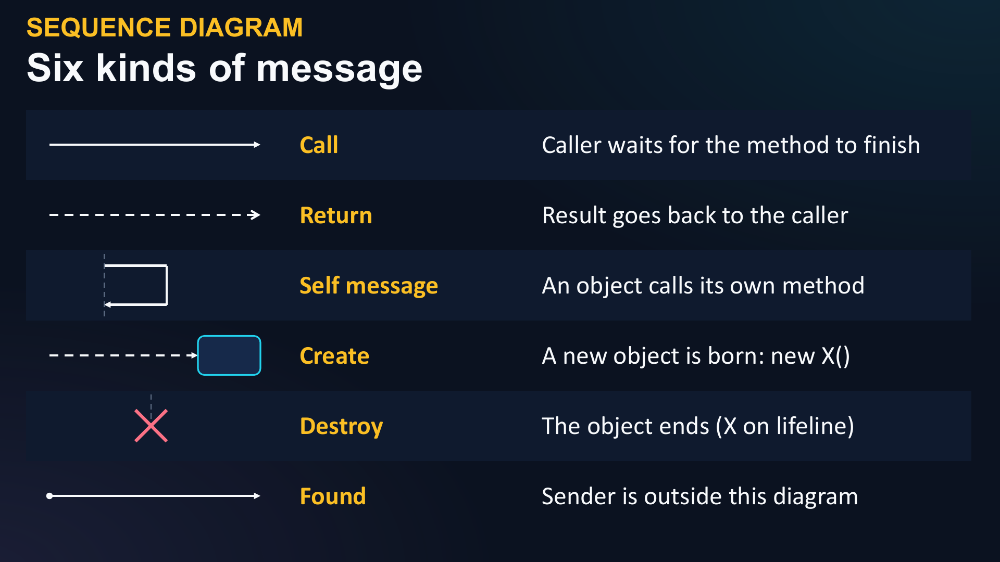
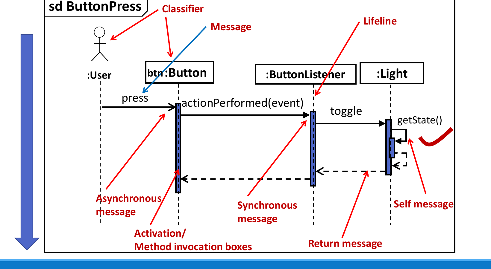
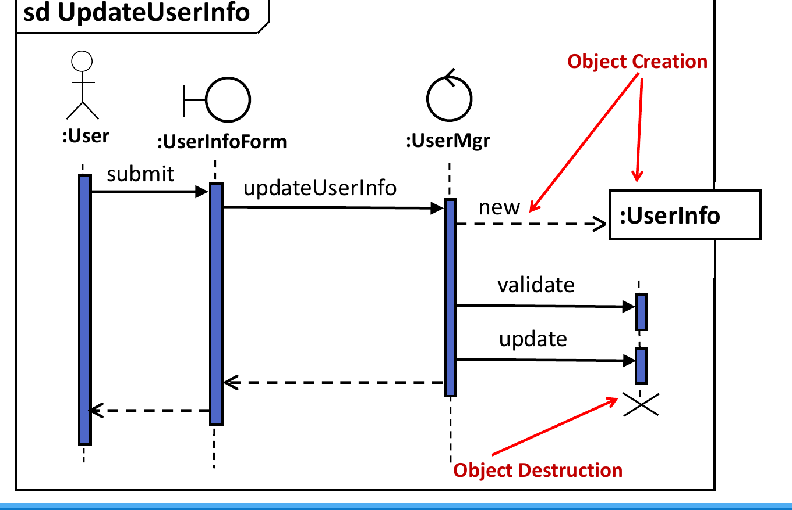
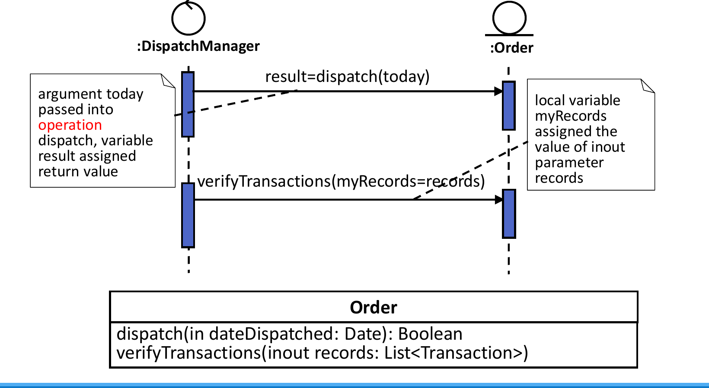
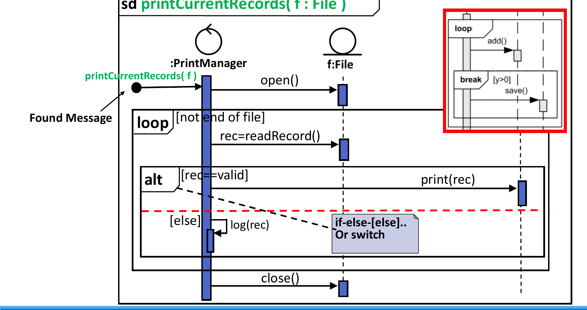
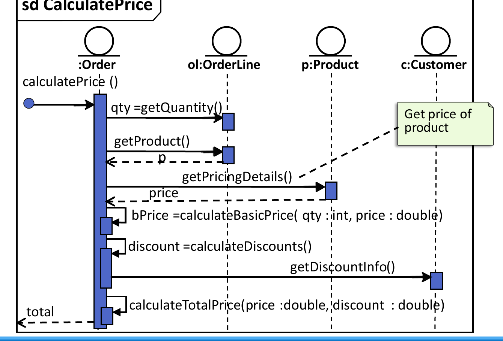
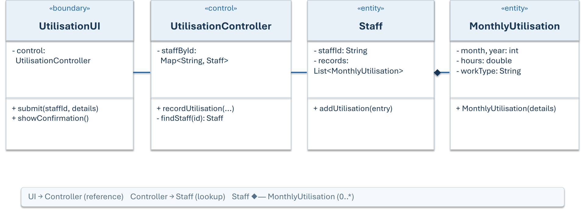
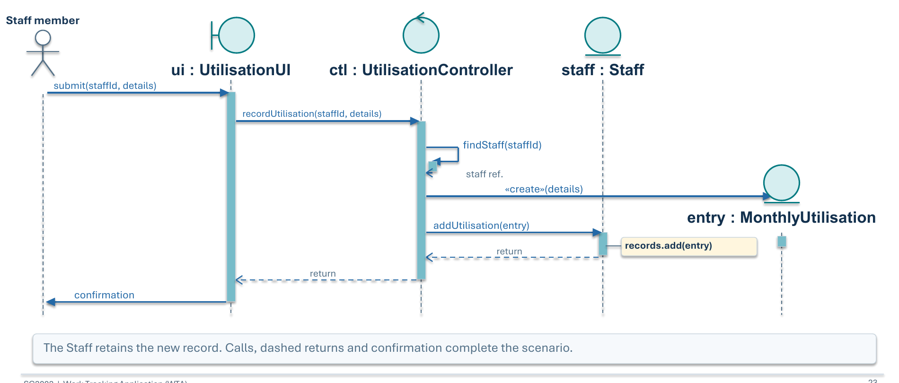

# Sequence Diagrams and Modelling an OO Application

<style>
table.wide-table { width: max-content; min-width: 100%; table-layout: auto; }
</style>

This chapter covers Lecture 7 (sequence diagrams), the Lecture 7 face-to-face
session (from requirements to a sequence diagram) and Lecture 8 (modelling an
OO application, CRC cards).

## 1. Class Diagram vs Sequence Diagram

| | Class diagram | Sequence diagram |
|---|---|---|
| Analogy | The **blueprint** | The **CCTV recording** |
| Shows | Which classes exist; their attributes, operations and relationships | Which **objects** take part in **one scenario**; who sends which message to whom, and in what order |
| Kind | Static structure, no time | Dynamic behaviour; time goes **down** the page |
| Scope | The whole system | One use case, often one path through it |

: { .wide-table }

A class can be in the class diagram and still be absent from a given sequence
diagram, if it takes no part in that scenario.

## 2. Elements of a Sequence Diagram



| Element | Notation | Meaning |
|---|---|---|
| **Frame** | Box with `sd Name` in the top-left corner | The whole interaction and its name, e.g. `sd ButtonPress` |
| **Actor** | Stick figure | A person or system outside the system |
| **Participant** | Box at the top: `name : Class` | One object (or an anonymous one: `: Class`) |
| **Lifeline** | Dashed vertical line under the box | The life of that object over time |
| **Activation bar** | Thin box on the lifeline | The time that the object is running a method |
| **Message** | Arrow from sender to receiver | A call to an operation of the receiver |
| **Return** | Dashed arrow back to the caller | The result goes back |

: { .wide-table }

### Participant names

| Written as | Meaning |
|---|---|
| `ui : UtilisationUI` | An object named `ui` of class `UtilisationUI`. `ui` is the object name; `UtilisationUI` is the class name. |
| `: UtilisationUI` | Some (anonymous) object of that class |
| `ui` | Named object, class not shown. Avoid this in design diagrams. |

: { .wide-table }

The class name must exist in the class diagram. An **actor** `Staff member`
and an **object** `staff : Staff` are different participants: one is the
person, the other is the data about the person inside the system.

### Kinds of message



| Message | Arrow | Meaning |
|---|---|---|
| **Synchronous call** | Solid line, **filled** arrowhead | The caller waits until the method finishes. Normal method calls. |
| **Asynchronous** | Solid line, **open** arrowhead | The caller does not wait. |
| **Return** | **Dashed** line, open arrowhead, back to the caller | The result of a call. Often optional. |
| **Self message** | Arrow that leaves and comes back to the same lifeline | An object calls its own method (a nested activation bar). A recursive call looks the same. |
| **Create** | Dashed arrow (often `new` or `<<create>>`) to the **box** of the new object, placed lower on the page | A new object starts its life here: `new X()` |
| **Destroy** | Big **X** at the end of a lifeline | The object ends |
| **Found** | Arrow that starts at a small filled circle | The sender is outside this diagram |
| **Lost** | Arrow that ends at a small filled circle | The message never reaches a receiver |

: { .wide-table }





### Message syntax



- `result = dispatch(today)`: call `dispatch` with argument `today`, and put the
  return value in the variable `result`.
- `verifyTransactions(myRecords = records)`: the parameter `myRecords` gets the
  value `records`.
- `v = mymsg(16, variab) : 96`: a reply that carries the return value `96`.
- `mymessage(14, -, 3.14, "hello")`: `-` means the argument is not defined.

## 3. Interaction Fragments

A **combined fragment** is a box around part of the diagram. Its operator is
in the top-left corner. A **guard** in `[ ]` gives the condition.

| Operator | Meaning | Java |
|---|---|---|
| **`alt`** | Choose **one** of several parts. Dashed lines divide the parts; each part has a guard. `[else]` is allowed. | `if / else if / else`, `switch` |
| **`opt`** | Run the part **only if** the guard is true. One part, no else. | `if` with no `else` |
| **`loop`** | Repeat the part while the guard is true (min and max counts are optional). | `for`, `while`, `do-while` |
| **`par`** | The parts run **in parallel**. | Threads |
| **`critical`** | A critical region: other messages cannot interleave. | `synchronized` |
| **`break`** | Run this part **instead of** the rest of the enclosing fragment (an exception path). | `break`, exception |
| **`ref`** | Refers to another sequence diagram (an interaction use). Reuses a shared part. | A method call to a shared routine |

: { .wide-table }

![opt with the guard [isAuthenticated]; ref boxes point to other diagrams.](images/7-fragment-opt-ref.png)



Keep the diagram for **one** scenario. Do not add a `loop` for a batch, or an
`alt` for an error path, if the use case you are drawing does not need it.

## 4. Turning a Sequence Diagram into Code

Rules:

1. Each **message** that arrives at an object is a **method in that object's
   class**. The name, parameters and return type come from the arrow.
2. The sender must be able to **reach** the receiver. It needs a reference: a
   field (association), a parameter, a local variable, or a value returned
   by an earlier call.
3. A **return** arrow (or `x = call()`) becomes a return value stored in a
   local variable.
4. A **self message** is a method of the same class, usually `private`.
5. A **create** message is `new ClassName(...)`.
6. Fragments become `if`, `if/else` and loops.
7. Partial code in an exam answer must still **compile**.



```java
public class Order {
    private Customer c;            // Order must reach Customer
    private OrderLine ol;          // and OrderLine: fields (associations)

    public double calculatePrice() {
        int qty = ol.getQuantity();
        Product p = ol.getProduct();             // return value gives the Product reference
        double price = p.getPricingDetails();
        double bPrice = calculateBasicPrice(qty, price);   // self message
        double discount = calculateDiscounts();            // self message
        return calculateTotalPrice(bPrice, discount);      // self message
    }
    private double calculateBasicPrice(int qty, double price) { return qty * price; }
    private double calculateDiscounts() { return c.getDiscountInfo(); }
    private double calculateTotalPrice(double price, double discount) { return price * discount; }
}
public class OrderLine {
    private int qty;
    private Product product;
    public int getQuantity() { return qty; }
    public Product getProduct() { return product; }
}
public class Product  { public double getPricingDetails() { return 100.0; } }
public class Customer { public double getDiscountInfo()   { return 10.0; } }
```

Note that `Order` has no field for `Product`. It gets the `Product` reference
from `ol.getProduct()`, so `Order` depends on `Product` only for this method.

## 5. From Requirements to Design (the Model-OO Process)

1. Read the requirements.
2. Find the **entity classes** (nouns; Chapter 6, Section 11).
3. Find the **use cases**, then add **boundary** and **control** classes.
4. Draw the **class diagram**.
5. Draw a **sequence diagram** for each important use case.
6. **Update the class diagram.** The sequence diagram often shows a missing
   operation or class. Add it, then check the interaction again. Expect this
   loop.
7. Implement and test.

If a sequence diagram needs a message that has no matching operation, revise
the class diagram. Do not draw the arrow anyway, and do not delete the use
case.

### Use cases

A **use case** is **one goal** that an **actor** wants to reach with the
system, from the trigger to the result. Name it with a **verb + noun**:
"Record Monthly Utilisation", "Create Project", "Track Issue".

- Find the actors, list each actor's goals, and group the requirements by goal.
- A requirement says what the system must do. A use case is one user goal.
- A use case name ("Record Monthly Utilisation") is **not** a class. The
  entity class is `MonthlyUtilisation`.
- Define the scenario exactly: the actor, the trigger, what counts as success,
  and how it finishes. A save is complete only when the new record is linked
  to its owner **and** the UI confirms it, not when `new` runs.

### Why boundary and control classes

Entity classes alone cannot finish a use case:

- Entities hold data and rules. They should not read input or print messages.
  → A **boundary** class talks to the user.
- A `Staff` object cannot search for itself among all staff.
  → A **control** class holds the collections and finds objects.
- Someone must run the steps (find, create, attach, confirm) in order.
  → The **control** class coordinates.

Benefits: you can change the screen (console to web) and change only the
boundary. You can test the rules with no UI. Each class has one reason to
change (Single Responsibility, Chapter 8).

| Class kind | Rules |
|---|---|
| Boundary | One per group of related use cases. Collects input, shows output. Checks only the input **format**, not business rules. Named `xxxUI` / `xxxForm`. |
| Control | One per group of use cases. **Coordinates; does not compute.** Owns the collections of entities. Usually holds the loops. Named `xxxController` / `xxxMgr` / `xxxCtrl`. |
| Entity | Holds its own data and the rules on that data. Keeps its own parts (a `Staff` keeps its own records). |

: { .wide-table }

A complete class diagram **may include** boundary, control and entity
classes. They are all real classes.



### Worked example: Record Monthly Utilisation



| Step | Message | From → To | Note |
|---|---|---|---|
| 1 | `submit(staffId, details)` | Actor → UI | Boundary receives input |
| 2 | `recordUtilisation(staffId, details)` | UI → Controller | UI holds a Controller reference |
| 3 | `findStaff(staffId)` | Controller → itself | Self message: look-up in its `staffById` map |
| 4 | `<<create>>(details)` | Controller → new `entry : MonthlyUtilisation` | The entry is new, so its box is lower |
| 5 | `addUtilisation(entry)` | Controller → Staff | Links the entry to its owner; Staff does `records.add(entry)` |
| 6 | returns, then confirmation | Staff → Controller → UI → Actor | The UI shows the success message |

: { .wide-table }

```java
class UtilisationController {
    private Map<String, Staff> staffById;             // control owns the collection
    void recordUtilisation(String staffId, int month, int year, double hours, String type) {
        Staff staff = findStaff(staffId);             // internal (self) call
        MonthlyUtilisation entry = new MonthlyUtilisation(month, year, hours, type);   // create
        staff.addUtilisation(entry);                  // Controller → Staff
    }
    private Staff findStaff(String id) { return staffById.get(id); }
}
class Staff {
    private List<MonthlyUtilisation> records = new ArrayList<>();
    void addUtilisation(MonthlyUtilisation entry) { records.add(entry); }   // Staff owns its records
}
```

General points from this example:

- **Creating** an object and **linking** it to its owner are two different
  steps.
- Each entity keeps its own parts. The control finds objects and passes them
  around, but does not keep the records.
- A collection (map or list) inside the controller is an implementation
  detail. It is not a separate lifeline.
- The class that **displays** the result is the boundary (UI).

## 6. CRC Cards and the Blackjack Case Study

A **CRC card** (Class–Responsibility–Collaborator; Kent Beck and Ward
Cunningham, 1989) is an index card for one class:

| Class name | Collaborators |
|---|---|
| Responsibilities (what the class knows and does) | Other classes it works with |

Why use them: they are portable (no computer), people can act out the system
by moving the cards, and they teach OO thinking. Expect the first cards to
change.

**Steps** (Blackjack example):

1. Study the requirements until you understand them.
2. List all the **nouns**: game, blackjack, dealer, house, players, player,
   card(s), deck, hand, face value, suit, ace, king, bet, winner…
3. **Eliminate** nouns that are not classes:
   - "Blackjack" and "game" are the system itself.
   - "House" is another name for the dealer.
   - "Players" and "cards": one `Player` and one `Card` class are enough.
   - "Face value" and "suit" are **attributes** of `Card`.
   - "Ace", "King", "Queen", "Jack" are values of a card attribute, not
     classes.
   - "Bet" can stay for future use, or be added later.
4. List the **verbs** to find each class's **responsibilities**. A `Deck`
   shuffles, deals the next card, and knows how many cards it has. A `Hand`
   knows its value and its number of cards and can show itself.
5. Review: remove unneeded responsibilities, rename unclear ones.
6. Fill in the CRC cards with collaborators, then draw the UML class diagram
   (`Card`, `Deck`, `Hand`, `Dealer`, `Player`).

## 7. Designing for Change (Restaurant Rush)

The group assignment adds requirements in stages (release 1, then 2, then 3)
to test **extensibility**. Good evidence of an extensible design:

- New behaviour goes into the classes that own that responsibility. Some small
  setup changes are normal.
- Earlier features and their tests still work.
- Bad signs: type checks (`if customer is VIP …`) spread across the code; many
  unrelated classes rewritten; old behaviour broken.
- Build each stage for its own requirements. Do not add empty classes for
  future features.

## 8. Quiz Traps

- Sequence diagram = one scenario over time (the "CCTV"). Class diagram =
  static structure (the "blueprint").
- `ui : UtilisationUI`: `ui` is the object, `UtilisationUI` is the class.
- Filled arrowhead = synchronous; open arrowhead = asynchronous; dashed =
  return; X = destroy; create points at the new box.
- A return goes back to the **caller** (Controller → UI for a UI → Controller
  call).
- `alt` = if/else; `opt` = if with no else; `loop` = repeat; `ref` = another
  diagram; `par` = parallel; `break` = exit path.
- Every message received means an operation in the receiver's class, and the
  sender needs a reference to the receiver (it does not need to inherit from
  it).
- Boundary displays; control coordinates and holds collections; entity holds
  data. A use case name is not a class.
- A missing operation found in a sequence diagram means: update the class
  diagram.
