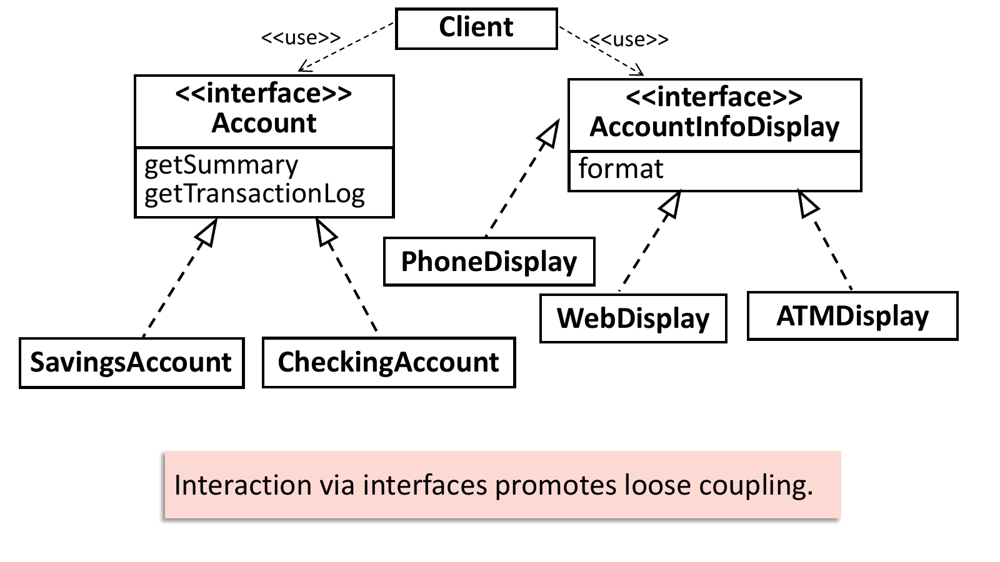
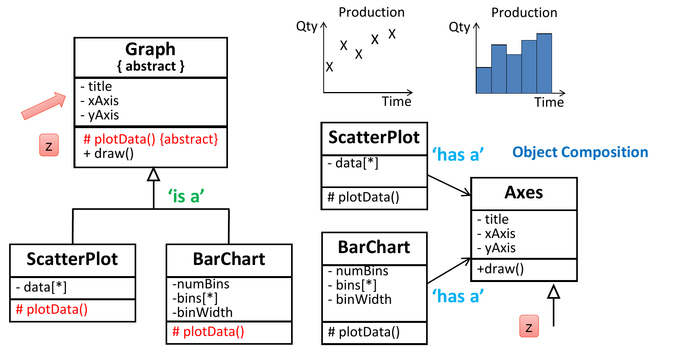
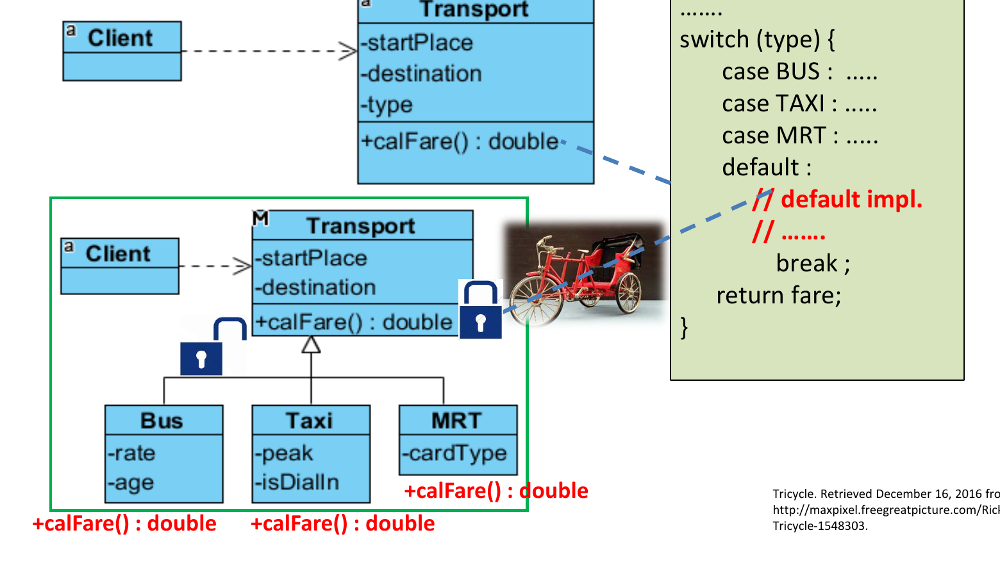
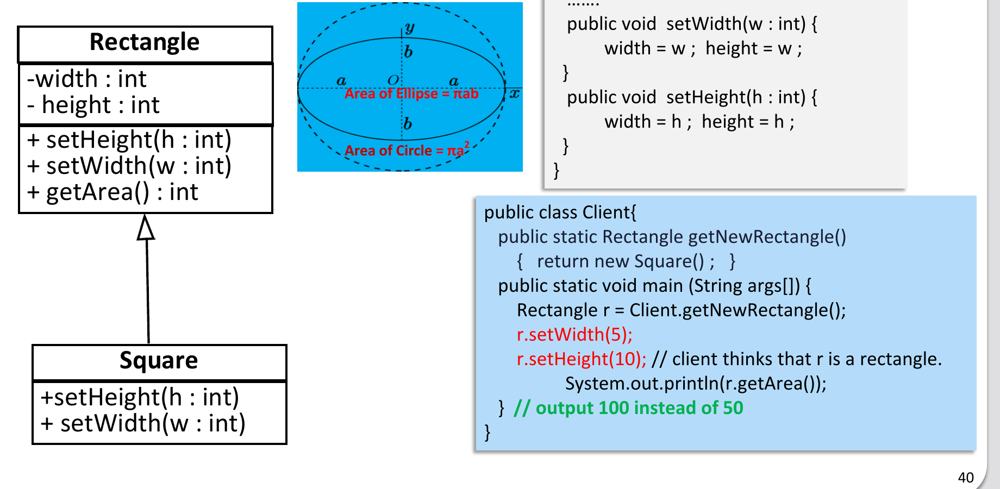
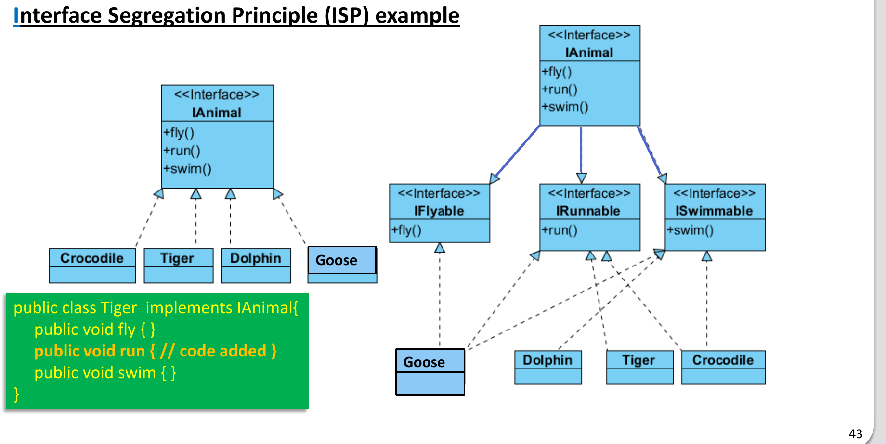

# Design Principles and SOLID

<style>
table.wide-table { width: max-content; min-width: 100%; table-layout: auto; }
</style>

This chapter covers Lecture 9. Quiz questions here usually describe a design
and ask which principle it breaks, or which principle a fix uses. Learn the
"sign of violation" column in Section 4.

## 1. Good and Bad Design

Software that works now is not always well designed. A bad design shows
**symptoms of rot** when you try to change it:

| Symptom | Meaning |
|---|---|
| **Rigidity** | Hard to change, even in simple ways. One change forces a chain of changes in other modules (a ripple or snowball effect). |
| **Fragility** | Each change breaks the software in many places, often in parts that have no clear link to the change. |
| **Immobility** | You cannot reuse a module in another project, or in another part of the same project, because it depends on too much other code. |

: { .wide-table }

## 2. The Goal: Make Change Cheap

The aim of OO design is to make software easy to change: to add features, to
change business rules, or to improve the design. Classes depend on each other,
so a change in one class can force changes in others. Most of OO design is
about **managing dependencies** to **minimise the impact of change**.

Design with **reusability**, **extensibility** and **maintainability** in
mind. You get these with **low (loose) coupling** and **high cohesion**.

| Term | Meaning | Want |
|---|---|---|
| **Coupling** | How much one class depends on the details of another class | **Low**: classes talk through small, clear interfaces |
| **Cohesion** | How closely the jobs inside one class belong together | **High**: each class does one focused job |
| **Encapsulation** | Each class hides its data and does its own work | Good: other classes do not need to know its inner workings |

: { .wide-table }

A **modular** program has simple, independent units that talk through
well-defined interfaces.

### Examples from the lecture

**Data persistence.** A `DataManager` that checks a customer's password by
reading the password from the database and comparing it itself needs to know
the inner workings of `Customer` (bad encapsulation). Better: each `Customer`
and `Account` validates and stores itself (`c.validate(pwd)`), and
`DataManager` only manages the entities.

**Finance index display.** `NASDAQ` holds the data **and** a `displayType`,
and calls `displayDailyData`, `displayMonthlyData` or `displayYearlyData` on
`DataDisplay`. Problems: tight coupling (each needs the other), low cohesion
(`NASDAQ` tracks data and also manages display), bad encapsulation (`NASDAQ`
knows how display works). Better: `NASDAQ` only gives `getData()` and
`notify()`. `DataDisplay` keeps its own `displayType` and decides how to show
the data.

**Bank account.** One `Account` class with `formatForATM`, `formatForWeb` and
`formatForPhone` mixes data and presentation. Better: an `Account` interface
(`getSummary`, `getTransactionLog`) with `SavingsAccount` and
`CheckingAccount`, and an `AccountInfoDisplay` interface (`format`) with
`ATMDisplay`, `WebDisplay` and `PhoneDisplay`. "Interaction via interfaces
promotes loose coupling."



## 3. Inheritance vs Delegation, Inheritance vs Role

**Delegation (composition) is often better than inheritance.** If `BarChart
extends Graph`, every change to `Graph` forces `BarChart` to be recompiled,
and `BarChart` is locked to `Graph`. If `BarChart` instead **has** an `Axes`
object and asks it to draw the axes, a change in `Axes` does not force a
change in `BarChart`. Inheritance is "is-a"; delegation is "has-a" plus
"ask the part to do the work".



**Role vs inheritance.** `Father`, `Mother` and `Grandfather` are not
subclasses of `Person`. They add no new state or behaviour; they are roles a
person plays. Use an enum such as `FAMILY_ROLE { FATHER, MOTHER, … }`, not
inheritance. Use a subclass only for real specialisation (new fields or
overridden methods), such as `Student` or `Lecturer`.

## 4. The SOLID Principles

| Letter | Principle | One-line rule | Sign of a violation | Usual fix |
|---|---|---|---|---|
| **S** | Single Responsibility (SRP) | A class should have only **one reason to change**. | One class does data **and** display **and** storage; a "God" class | Split it into classes with one job each |
| **O** | Open–Closed (OCP) | Open for **extension**, closed for **modification**. | A `switch` / `if-else` on a type code; adding a new type means editing old code | Abstract class or interface; one subclass per type |
| **L** | Liskov Substitution (LSP) | Subtypes must be **substitutable** for their base types. | A subclass that needs more input, gives less output, or breaks the parent's behaviour (Square/Rectangle) | Do not inherit; rethink the hierarchy |
| **I** | Interface Segregation (ISP) | Many **client-specific** interfaces are better than one general-purpose interface. | A class implements methods it does not use, often with empty bodies (a "fat" interface) | Split the interface into small ones |
| **D** | Dependency Injection / Inversion (DIP) | High-level modules and low-level modules both depend on **abstractions**. | A high-level class names a concrete low-level class directly (`new HPPrinter()`) | Depend on an interface; pass the concrete object in |

: { .wide-table }

### S: Single Responsibility Principle

"There should never be more than one reason for a class to change." SRP is
the same idea as **high cohesion**.

- Each responsibility is a direction in which the class may need to change.
- Two responsibilities in one class are coupled. A change for one job can
  break the other job.
- Avoid a **"God" class** that does everything.
- Example: an `Account` with `deposit`, `withdraw`, `toXML` and `fromXML` has
  two jobs: banking rules and data format. Move `toXML`/`fromXML` to a separate
  formatter class.
- A `Student` class with `calculateAverage`, `getHighestScore`,
  `getLowestScore` and `isPassed` does **not** break SRP. All four change for
  the same reason (how scores are evaluated).

### O: Open–Closed Principle

"A module should be open for extension but closed for modification"
(Bertrand Meyer). You can change what a module does without changing its
source code. **Abstraction is the key** to OCP.

```java
// Violates OCP: a new transport type means editing this method
double calFare() {
    switch (type) {
        case BUS:  ...
        case TAXI: ...
        case MRT:  ...
    }
}

// Follows OCP: a new type is a new subclass; Transport and Client do not change
abstract class Transport { abstract double calFare(); }
class Bus  extends Transport { double calFare() { ... } }
class Taxi extends Transport { double calFare() { ... } }
class Tricycle extends Transport { double calFare() { ... } }   // added later
```



OCP works through polymorphism (Chapter 4): code that uses the base type
stays the same when new subclasses appear. Adding `PayNow` and `PayPal` by
editing an existing payment class breaks OCP.

### L: Liskov Substitution Principle

"If for each object o1 of type S there is an object o2 of type T such that
for all programs P defined in terms of T, the behaviour of P is unchanged when
o1 is substituted for o2, then S is a subtype of T." (Barbara Liskov, 1988.)

In short: **subtypes must be substitutable for their base types**. Code that
uses a base class must still work correctly when it gets any subclass.

**Design by contract.** Each public method has a **pre-condition** (what must
be true before it runs) and a **post-condition** (what it promises after). A
subclass method is substitutable if:

- its pre-conditions are **no stronger** than the base method's: it **expects
  no more**;
- its post-conditions are **no weaker** than the base method's: it **provides
  no less**.

Example: `AccountInfoDisplay.format(acc)` accepts `null` and returns full
details. An `ATMDisplay.format(acc)` that assumes `acc` is not `null`
**expects more**, and one that returns only partial details **provides
less**. Both break LSP.

**Classic example: Square extends Rectangle.**

```java
class Square extends Rectangle {
    public void setWidth(int w)  { width = w; height = w; }
    public void setHeight(int h) { width = h; height = h; }
}
Rectangle r = new Square();
r.setWidth(5);
r.setHeight(10);
System.out.println(r.getArea());   // 100, but a Rectangle user expects 50
```



Mathematically a square is a rectangle, but in code a `Square` cannot keep
the behaviour that users of `Rectangle` rely on (setting width does not change
height). The same problem happens with `Circle extends Ellipse`: calling only
`setMajor()` on a circle makes it no longer a circle. The fix is to not use
this inheritance.

### I: Interface Segregation Principle

"Many client-specific interfaces are better than one general-purpose
interface." Classes should not depend on interfaces that they do not use.
Avoid **fat interfaces**.

Example: one `IAnimal` interface with `fly()`, `run()` and `swim()`. A `Tiger`
must write an empty `fly()` and `swim()`. Split it into `IFlyable`,
`IRunnable` and `ISwimmable`. Each animal implements only what it can do. A
`Goose` implements all three; a `Dolphin` implements only `ISwimmable`.



### D: Dependency Injection (Inversion) Principle

A. High-level modules should not depend on low-level modules. Both should
depend on **abstractions**.
B. Abstractions should not depend on details. Details should depend on
abstractions.

- A **high-level module** holds the main logic (for example `Restaurant`,
  `Admin`). A **low-level module** does one detailed job (for example
  `HPPrinter`, `XMLExporter`).
- If `Restaurant` creates and uses `HPPrinter` directly, it breaks DIP. You
  cannot change the printer without changing `Restaurant`.
- Fix: `Restaurant` uses a `Printer` interface. `HPPrinter` implements it. The
  concrete printer is given to `Restaurant` from outside (through the
  constructor or a setter). This is **dependency injection**.

```java
interface Printer { void print(String s); }
class HPPrinter implements Printer { public void print(String s) { ... } }

class Restaurant {
    private final Printer printer;                 // depends on the abstraction
    Restaurant(Printer printer) { this.printer = printer; }   // injected
}
```

- When high-level modules do not depend on low-level ones, you can reuse the
  high-level modules easily.
- DIP is at the heart of **framework** design. It is also called **Inversion
  of Control (IoC)**: the framework is in control, creates your class, and
  calls your code ("callbacks"). You plug in by extending the framework's
  abstract class or implementing its interface.

## 5. Design Patterns

A **design pattern** is a proven solution to a known design problem. The
"Gang of Four" (Gamma, Helm, Johnson, Vlissides) catalogued 23 of them.
Examples: **Singleton**, **Adapter**, **Observer**, and the architectural
pattern **Model–View–Controller (MVC)**.

- **Principles** (SOLID, DRY "don't repeat yourself", KISS "keep it simple")
  are broad guidelines that shape the quality of the code.
- **Patterns** are concrete solutions that put the principles into practice.
  Use them with thought, not by copying their structure.

## 6. Quiz Traps

- Hard to change = rigidity. Breaks in unrelated places = fragility. Cannot
  reuse = immobility.
- Want **low coupling, high cohesion**. SRP = cohesion.
- A `switch` on a type that grows with each new type: **OCP** violation.
- Subclass that changes expected behaviour (Square/Rectangle, Circle/Ellipse):
  **LSP** violation. "Expect no more, provide no less."
- Class forced to implement methods it does not need (empty bodies): **ISP**
  violation.
- High-level class that names a concrete low-level class: **DIP** violation.
  DIP = dependency injection = inversion of control.
- In the course slides the D is written "Dependency **Injection** Principle".
  Other books call it "Dependency **Inversion**". Both mean the same rule.
- Several methods that all change for the same reason do not break SRP.
- Prefer delegation (has-a) to inheritance when you only want to reuse code.
