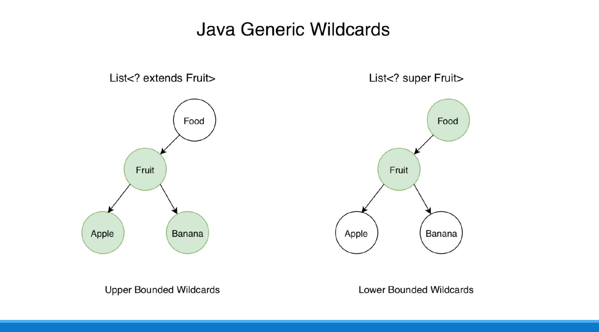
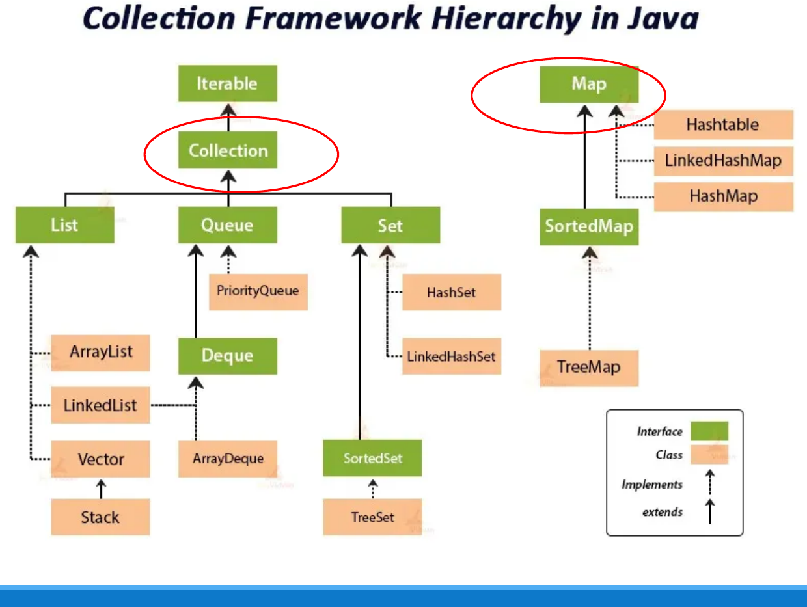
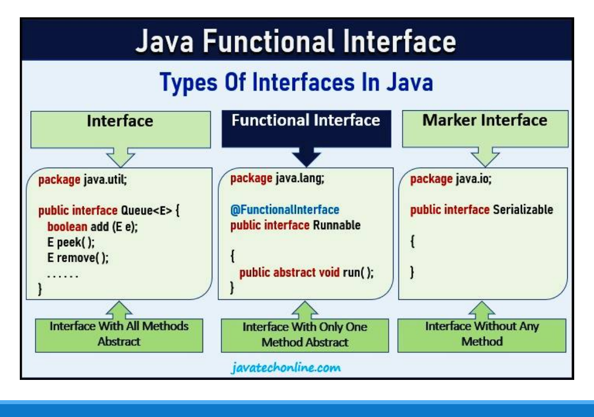
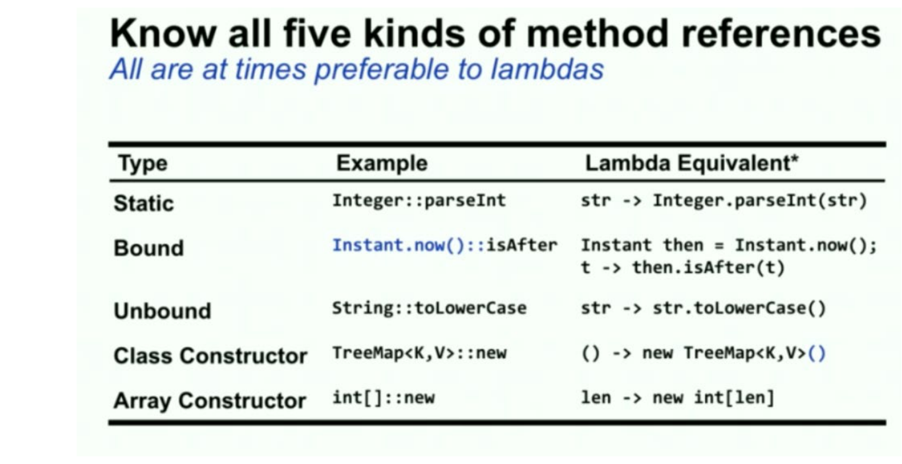
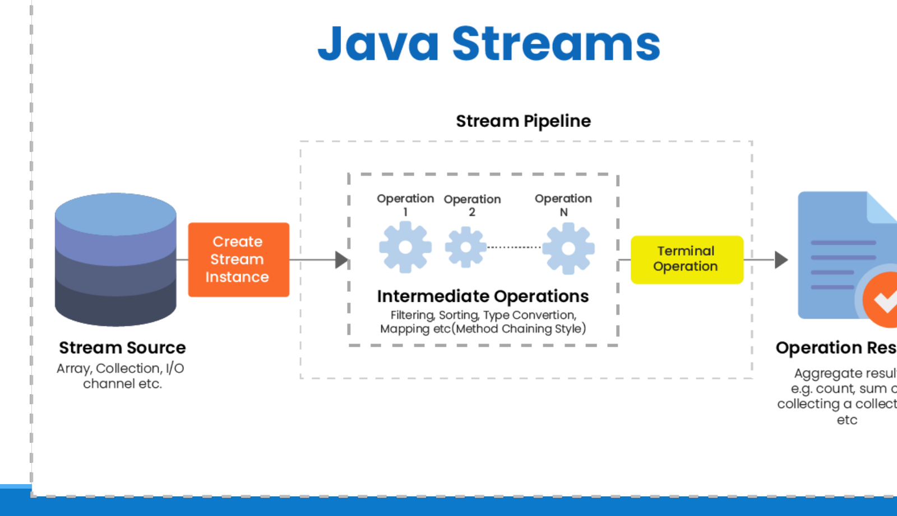

# Modern Java: Generics, Collections, Lambdas, Streams and Switch

<style>
table.wide-table { width: max-content; min-width: 100%; table-layout: auto; }
</style>

This chapter covers Lecture 10 and Tutorial 9. Default and static methods in
interfaces (also Lecture 10) are in Chapter 3, Section 4.

| Java version | Features |
|---|---|
| Java 5 | Generics, collections improvements, enhanced `for` loop |
| Java 7 | Diamond operator `<>` |
| Java 8 | Lambda expressions, Streams API, default and static interface methods |
| Java 12+ | Enhanced `switch` (arrow labels, switch expressions, `yield`) |

: { .wide-table }

Main benefits: type safety, fewer run-time errors, shorter code, and a
functional style of programming.

## 1. Generics (Java 5)

### The problem generics solve

Before Java 5, a collection held `Object`. You could add any type, and you had
to cast every element you took out. A wrong cast compiled, then failed at run
time.

```java
List myList = new ArrayList();          // raw type: no type safety
myList.add("Java");
myList.add(2);                          // compiles: any Object is allowed
String s = (String) myList.get(1);      // compiles, ClassCastException at run time
```

With generics, you give the element type in angle brackets. The compiler
checks every `add`, and `get` needs no cast.

```java
List<String> myList = new ArrayList<>();
myList.add("Java");
myList.add(2);                          // COMPILE ERROR: caught early
String s = myList.get(0);               // no cast needed
```

**Benefits:** type errors move from run time to compile time, and casts go
away.

### Diamond operator (Java 7)

```java
List<String> list = new ArrayList<String>();   // Java 5: type on both sides
List<String> list = new ArrayList<>();         // Java 7+: <> lets the compiler infer it
```

### Generic class

```java
public class Box<T> {                  // T is a type parameter
    private T content;
    public void set(T content) { this.content = content; }
    public T get() { return content; }
}
Box<Integer> intBox = new Box<>();
intBox.set(123);
Integer n = intBox.get();              // returns Integer, no cast

class Pair<T, U> {                     // two type parameters
    private T first; private U second;
    public Pair(T f, U s) { first = f; second = s; }
    public T getFirst() { return first; }
    public U getSecond() { return second; }
}
Pair<String, Double> price = new Pair<>("Laptop", 799.99);
```

`ArrayList` itself is generic: `public class ArrayList<E> … { public boolean
add(E element) … }`.

### Generic method

Put the type parameter **before the return type**:

```java
public static <T> T getFirst(T[] arr) { return arr[0]; }

public static <T> void printArray(T[] arr) {
    for (T item : arr) System.out.print(item + " ");
}
printArray(new Integer[]{1, 2});   // OK
printArray(new String[]{"a"});     // OK
printArray(new int[]{1, 2});       // COMPILE ERROR
```

**Type arguments must be reference types, not primitives.** `List<int>` is a
compile error; use `List<Integer>`. Java **autoboxes** an `int` into an
`Integer` when you add it. But an `int[]` is not a `T[]` for any `T`, because
`T` cannot be `int`. To accept primitive arrays, write an overload such as
`printArray(int[] arr)`, or use the wrapper array `Integer[]`.

### Type parameter names

| Name | Stands for | Example |
|---|---|---|
| `E` | Element | `List<E>` |
| `K`, `V` | Key, Value | `Map<K, V>` |
| `N` | Number | |
| `T` | Type (the first one) | `Box<T>` |
| `S`, `U`, `V` | 2nd, 3rd, 4th types | `Pair<T, U>` |

: { .wide-table }

### Wildcards

`List<String>` is **not** a `List<Object>`, even though a `String` is an
`Object`. `List<Object> o = new ArrayList<String>();` is a compile error.
Wildcards make a method accept a family of generic types.

| Wildcard | Meaning | You can |
|---|---|---|
| `List<?>` | Unbounded: a list of some unknown type | Read elements as `Object` |
| `List<? extends Fruit>` | **Upper bound**: `Fruit` or any **subclass** (`Apple`, `Banana`) | Read elements as `Fruit`. You cannot add (except `null`). |
| `List<? super Fruit>` | **Lower bound**: `Fruit` or any **superclass** (`Food`, `Object`) | Add `Fruit` objects. Reading gives only `Object`. |

: { .wide-table }



```java
public static void printList(List<?> list) {
    for (Object e : list) System.out.println(e);
}
printList(Arrays.asList("Apple", "Banana"));   // works with List<String>
printList(Arrays.asList(10, 20));              // works with List<Integer>
```

Memory aid: "**extends** to read, **super** to write" (producer `extends`,
consumer `super`).

## 2. The Collections Framework (Java 5+)



| Interface | What it is | Main classes |
|---|---|---|
| `List` | Ordered, allows duplicates, index access | `ArrayList` (fast get), `LinkedList` (fast insert/remove), `Vector`, `Stack` |
| `Set` | No duplicates | `HashSet` (no order), `LinkedHashSet` (insertion order), `TreeSet` (sorted, via `SortedSet`) |
| `Queue` / `Deque` | Process in order; `Deque` adds both ends | `PriorityQueue`, `ArrayDeque`, `LinkedList` |
| `Map` | Key → value pairs; keys are unique | `HashMap`, `LinkedHashMap`, `TreeMap` (sorted keys), `Hashtable` |

: { .wide-table }

- `Iterable` → `Collection` → `List`, `Set`, `Queue`.
- **`Map` does not extend `Collection`.** It is a separate root.
- Declare the variable with the interface type and create a concrete class:
  `List<String> l = new ArrayList<>();`. This is "program to an interface"
  (DIP in Chapter 8): you can change `ArrayList` to `LinkedList` in one place.

**Useful methods.**

```java
Map<String, Integer> freq = new HashMap<>();
for (String p : sales)
    freq.put(p, freq.getOrDefault(p, 0) + 1);    // count each product
for (Map.Entry<String, Integer> e : freq.entrySet())
    System.out.println(e.getKey() + ": " + e.getValue());

Collections.sort(list);                           // ascending (natural order)
Collections.sort(list, Collections.reverseOrder()); // descending
Collections.shuffle(list);
Collections.max(list); Collections.min(list);
list.sort(null);                                  // List.sort (Java 8), natural order
```

- `Collections.sort(list)` and `list.sort(comparator)` give the same result.
  `Collections.sort` is a static helper in the `Collections` utility class;
  `List.sort` is an instance method on the list (Java 8), and
  `Collections.sort` now calls it.
- Sorting in natural order a list that contains `null` throws a
  `NullPointerException`.

## 3. Ways to Go Through a Collection

| Way | Good for |
|---|---|
| Basic `for (int i = 0; i < list.size(); i++)` | Index access; changing elements by index |
| Enhanced `for (String s : list)` | Simple reading of every element |
| `Iterator<T>` with `hasNext()` / `next()` / `remove()` | Removing elements safely while looping |
| `list.forEach(...)` / `list.stream().forEach(...)` | Functional style, with a lambda |

: { .wide-table }

### Enhanced `for` loop (Java 5)

```java
for (Type variable : arrayOrCollection) { ... }
```

- It works on arrays and on any class that implements `Iterable` (all
  collections, and your own class if it implements `Iterable<T>`).
- It has no index. You cannot know the position or go backwards.
- The loop variable is a **copy**. `for (int v : arr) v *= 2;` does **not**
  change the array.
- Do not add to or remove from a collection inside an enhanced `for`. This
  usually throws a **`ConcurrentModificationException`**. Use an `Iterator`
  and call `iterator.remove()`.

```java
Iterator<String> it = list.iterator();
while (it.hasNext()) {
    if (it.next().equals("Banana")) it.remove();   // safe removal
}
```

## 4. Lambda Expressions (Java 8)

A **lambda expression** is a short way to write a method with no name. You use
it where Java expects a **functional interface**.

### From a class to an anonymous class to a lambda

```java
interface Greeting { void sayHello(); }

// 1. Anonymous class: a class with no name, made and used in one place
Greeting g1 = new Greeting() {
    public void sayHello() { System.out.println("Hello, World!"); }
};

// 2. Lambda: the same thing, shorter
Greeting g2 = () -> System.out.println("Hello, World!");
g2.sayHello();
```

```java
Runnable r = new Runnable() {                    // before
    @Override public void run() { System.out.println("Hello, World!"); }
};
Runnable r = () -> System.out.println("Hello, World!");   // after
```

### Syntax

`(arguments) -> { body }`: argument list, arrow token, body.

| Case | Example |
|---|---|
| No arguments | `() -> System.out.println("Hello")` |
| One argument (brackets optional) | `s -> System.out.println(s)` |
| Two arguments | `(x, y) -> x + y` |
| Explicit types | `(Integer x, Integer y) -> x + y` |
| Several statements (braces and `return` needed) | `(x, y) -> { System.out.println(x); return x + y; }` |

: { .wide-table }

A one-expression body returns its value with no `return` keyword. A body in
braces needs `return` if it gives a value.

### Functional interfaces

A **functional interface** has **exactly one abstract method**. A lambda can
only be used for a functional interface, because the lambda gives the body of
that one method. Mark it with `@FunctionalInterface` so the compiler checks
the rule. (Default and static methods do not count.)



| Kind | Abstract methods | Example |
|---|---|---|
| Normal interface | Many | `Queue<E>` |
| **Functional interface** | Exactly one | `Runnable`, `Comparator<T>`, `Consumer<T>` |
| **Marker interface** | None | `Serializable` |

: { .wide-table }

Built-in functional interfaces in `java.util.function`:

| Interface | Method | Shape |
|---|---|---|
| `Consumer<T>` | `void accept(T t)` | takes one value, returns nothing |
| `BiConsumer<T, U>` | `void accept(T t, U u)` | takes two values, returns nothing |
| `Function<T, R>` | `R apply(T t)` | turns T into R |
| `BiFunction<T, U, R>` | `R apply(T t, U u)` | turns two values into R |
| `Predicate<T>` | `boolean test(T t)` | yes/no test (used by `filter`) |
| `Supplier<T>` | `T get()` | gives a value, takes nothing |

: { .wide-table }

```java
BiConsumer<Integer, String> show = (a, b) -> System.out.println(a + " and " + b);
show.accept(5, "Hello");     // 5 and Hello
```

**Can every interface be replaced by a lambda?** No. Only a functional
interface. An interface with two or more abstract methods needs a class or an
anonymous class.

**Rules and limits:**

- A lambda can use a local variable from outside only if that variable is
  **final or effectively final** (never changed after it gets its value).
  Otherwise: compile error.
- Inside a lambda, `this` means the enclosing object. Inside an anonymous
  class, `this` means the anonymous object.
- **Why lambdas:** shorter code (no class or method name, no boilerplate),
  easier to read, and they work well with `Consumer`, `BiFunction` and the
  Streams API.
- Best practice: keep lambdas short; use method references where possible;
  avoid heavy logic inside a lambda.

### Method references

A **method reference** `Class::method` is a shorter lambda that only calls one
existing method.



| Kind | Example | Same as the lambda |
|---|---|---|
| Static | `Integer::parseInt` | `str -> Integer.parseInt(str)` |
| Bound (a given object) | `System.out::println` | `x -> System.out.println(x)` |
| Unbound (any object of the class) | `String::toLowerCase` | `str -> str.toLowerCase()` |
| Constructor | `TreeMap::new` | `() -> new TreeMap<>()` |
| Array constructor | `int[]::new` | `len -> new int[len]` |

: { .wide-table }

## 5. Streams API (Java 8)

A **stream** is a pipeline that processes the elements of a source (a
collection, an array, an I/O channel) step by step.



```java
List<String> names = Arrays.asList("Alice", "Bob", "Charlie", "David");
List<String> result = names.stream()               // 1. create the stream
        .filter(n -> n.startsWith("A"))            // 2. intermediate
        .map(String::toUpperCase)                  //    intermediate
        .collect(Collectors.toList());             // 3. terminal
System.out.println(result);                        // [ALICE]
```

### Key features

| Feature | Meaning |
|---|---|
| **Does not store data** | A stream reads from a source; it is not a collection. |
| **Does not change the source** | Operations make new results. The original list stays the same. |
| **Lazy** | Intermediate operations run only when a terminal operation starts. A pipeline with no terminal operation does nothing. |
| **Method chaining** | Write many operations in one readable chain. |
| **Single use** | After a terminal operation, the stream is used up. Using it again throws `IllegalStateException`. |
| **Parallel** | `list.parallelStream()` splits the work across processor cores, for large data sets. |

: { .wide-table }

### Common operations

| Operation | Kind | What it does |
|---|---|---|
| `filter(predicate)` | Intermediate | Keeps the elements for which the test is `true` |
| `map(function)` | Intermediate | Changes **each** element into **one** new element |
| `flatMap(function)` | Intermediate | Changes each element into a **stream** and joins all of them into one flat stream |
| `sorted()` | Intermediate | Sorts in natural order (or with a comparator) |
| `distinct()` | Intermediate | Removes duplicates |
| `forEach(action)` | Terminal | Does an action for each element |
| `collect(Collectors.toList())` | Terminal | Puts the results into a collection |
| `count()` | Terminal | Number of elements (a `long`) |
| `reduce(...)` | Terminal | Combines all elements into one value (e.g. a sum) |

: { .wide-table }

```java
// strings of length >= 5, uppercased, into a new list
List<String> out = words.stream().filter(w -> w.length() >= 5)
                         .map(String::toUpperCase).collect(Collectors.toList());
long howMany = words.stream().filter(w -> w.length() >= 5).count();

List<Integer> squares = nums.stream().map(n -> n * n).collect(Collectors.toList());

// map vs flatMap
List<List<Integer>> nested = List.of(List.of(1, 2), List.of(3));
nested.stream().flatMap(List::stream).collect(Collectors.toList());   // [1, 2, 3]
```

Trace example: `["a", "bb", "ccc"]` with `filter(s -> s.length() > 1)`, then
`map(String::toUpperCase)`, then `forEach(System.out::print)` prints `BBCCC`.

## 6. Enhanced `switch` (Java 12+)

```java
// traditional: needs break, falls through if you forget it
switch (day) {
    case 1: case 2: case 3: case 4: case 5: dayType = "Weekday"; break;
    case 6: case 7:                         dayType = "Weekend"; break;
    default:                                dayType = "Invalid day";
}

// enhanced: arrow labels, several labels per case, used as an expression
String dayType = switch (day) {
    case 1, 2, 3, 4, 5 -> "Weekday";
    case 6, 7          -> "Weekend";
    default            -> "Invalid day";
};

// yield returns a value from a block
int score = switch (grade) {
    case 'A' -> { System.out.println("Excellent"); yield 100; }
    case 'B' -> 85;
    default  -> 50;
};

// works well with enums
String activity = switch (day) {
    case SATURDAY, SUNDAY -> "Relax";
    default               -> "Work";
};
```

- **No fall-through.** An arrow case runs only its own code, so no `break` is
  needed. This removes a common bug.
- **Expression.** The `switch` gives a value that you can assign directly.
- A switch **expression** must cover every possible value. For `int`, `char`
  or `String`, that means a `default` case. For an enum, listing every
  constant is enough.
- `yield` gives the value from a block `{ }` inside a switch expression.
- It works with `int`, `char`, `String`, enums (and their wrappers). Example:
  `case "MON", "TUE" -> ...`.

## 7. Quiz Traps

- Raw `List` + wrong cast: compiles, then `ClassCastException`. With `List<String>`,
  `add(2)` is a compile error.
- `List<int>` is a compile error. `int[]` cannot be passed to `T[]`.
- `List<String>` is not a `List<Object>`. `? extends` = read; `? super` = write.
- Generic method syntax: `public static <T> T getFirst(T[] arr)`.
- `Map` is not a `Collection`. `Set` has no duplicates.
- Removing inside an enhanced `for`: `ConcurrentModificationException`. Use
  `iterator.remove()`.
- A lambda needs a functional interface (exactly one abstract method).
  Captured local variables must be effectively final.
- `Serializable` is a marker interface; `Runnable` is a functional interface.
- Streams are lazy (no terminal operation → nothing runs), do not change the
  source, and can be used only once.
- `map` gives one output per input; `flatMap` flattens streams into one.
- Enhanced switch: no fall-through, can return a value, `yield` in a block.
